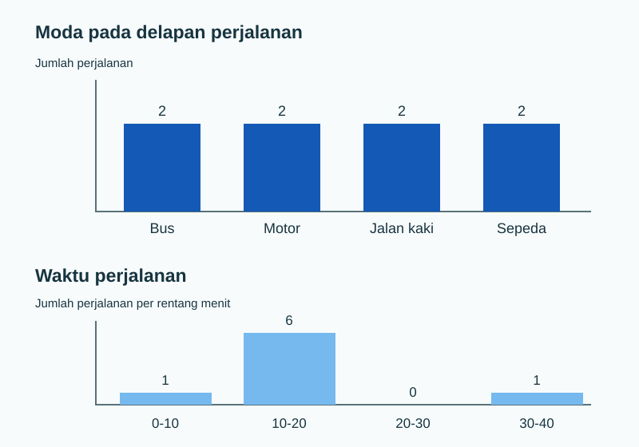

Statistik deskriptif merangkum data menjadi ukuran yang mudah dibaca. Awali dengan memastikan unit observasi, definisi variabel, dan kualitas nilainya. Ukuran pusat yang dipilih harus sesuai dengan skala pengukuran dan pertanyaan.

Untuk menjalankan contoh, unggah [CSV perjalanan](../../unduh-data/) dan baca datanya:

```python
import pandas as pd
data = pd.read_csv("perjalanan_contoh.csv")
```

## Tiga ukuran pusat

| Ukuran | Cara kerja | Kapan berguna |
|---|---|---|
| Rata-rata (*mean*) | Jumlah seluruh nilai dibagi banyak nilai | Nilai numerik, ketika semua besar nilai ingin diperhitungkan |
| Median | Nilai tengah setelah diurutkan | Nilai numerik dengan sebaran miring atau nilai ekstrem |
| Modus | Nilai atau kategori yang paling sering muncul | Kategori, atau angka dengan pengulangan yang bermakna |

Untuk nilai `x₁, x₂, ..., xₙ`, rata-rata adalah `x̄ = (x₁ + x₂ + ... + xₙ) / n`. Jika banyak nilai genap, median adalah rata-rata dua nilai tengah. Modus boleh lebih dari satu atau tidak unik.

| Skala variabel | Ukuran pusat yang dapat dijelaskan | Yang tidak boleh disimpulkan |
|---|---|---|
| Nominal | Modus atau kategori terbanyak | “Rata-rata moda” |
| Ordinal | Median kategori dan distribusi jawaban | Selisih antarkategori pasti sama |
| Interval | Mean, median, modus sesuai bentuk data | Rasio “dua kali” dari nilai mentah |
| Rasio | Mean, median, modus sesuai tujuan | Mean mewakili setiap individu |

## Hitung kecil dengan tangan

Untuk waktu 10, 20, dan 30 menit, rata-rata adalah `(10 + 20 + 30) / 3 = 20`. Median juga 20. Jika 30 diganti 90, rata-rata menjadi 40, tetapi median tetap 20. Inilah alasan kedua ukuran dapat menceritakan hal berbeda.

## Jalankan pada data contoh

```python
waktu = data["waktu_menit"]
print("Jumlah:", len(waktu))
print("Rata-rata:", round(waktu.mean(), 2))
print("Median:", waktu.median())
print(data["moda"].value_counts().to_string())
```

Keluaran:

```text
Jumlah: 8
Rata-rata: 15.0
Median: 13.0
moda
Bus           2
Motor         2
Jalan kaki    2
Sepeda        2
```

Interpretasi: rata-rata waktu pada **delapan perjalanan ilustratif ini** adalah 15 menit. Median 13 menit membagi data terurut menjadi dua bagian sama besar. Nilai 30 menit ikut menarik rata-rata ke atas. Kesimpulan itu tidak berlaku otomatis untuk sebuah kota.

Urutkan nilainya agar median dapat diperiksa dengan mata: `8, 10, 12, 12, 14, 16, 18, 30`. Dua nilai tengah adalah 12 dan 14, sehingga median `(12 + 14) / 2 = 13`. Jumlah seluruh waktu adalah 120 menit; `120 / 8 = 15`.

```python
print(sorted(waktu.tolist()))
print(waktu.mode().tolist())
```

Keluaran:

```text
[8, 10, 12, 12, 14, 16, 18, 30]
[12]
```

Modus waktu adalah 12 menit karena muncul dua kali. Untuk `moda`, keempat kategori sama-sama muncul dua kali, sehingga tidak ada satu moda dominan. Jangan memilih satu kategori hanya karena tampil paling atas pada `value_counts()`.

### Mengapa mean dan median berbeda?

Mean memakai **besar setiap nilai**. Menambah 10 menit pada satu perjalanan menaikkan mean delapan baris sebesar `10/8 = 1,25` menit. Median memakai **posisi setelah urut**; perubahan pada nilai paling tinggi mungkin tidak memengaruhi dua nilai tengah sama sekali. Karena itu, mean sensitif terhadap ekor, sedangkan median lebih tahan.

```python
ubah = waktu.copy()
ubah.iloc[-1] = 40
print("Mean sebelum/sesudah:", waktu.mean(), ubah.mean())
print("Median sebelum/sesudah:", waktu.median(), ubah.median())
```

Keluaran:

```text
Mean sebelum/sesudah: 15.0 16.25
Median sebelum/sesudah: 13.0 13.0
```

Ini **percobaan perubahan satu angka**, bukan koreksi data. Ia memperlihatkan perilaku ukuran pusat.

## Rata-rata tertimbang

Jika tiap nilai mewakili banyak pengamatan berbeda, gunakan bobot. Misalkan dua kelompok memiliki rata-rata 10 dan 20 menit, dengan masing-masing 3 dan 1 perjalanan. Rata-rata gabungannya `(3×10 + 1×20) / (3+1) = 12,5`, bukan 15.

```python
rata_kelompok = [10, 20]
jumlah_perjalanan = [3, 1]
tertimbang = sum(a * n for a, n in zip(rata_kelompok, jumlah_perjalanan)) / sum(jumlah_perjalanan)
print(tertimbang)
```

Keluaran: `12.5`. Bobot harus menyatakan jumlah atau kepentingan yang didefinisikan jelas. Jangan memakai bobot hanya agar hasil terlihat lebih sesuai harapan.

### Mean terpangkas sebagai pembanding

Mean terpangkas membuang proporsi yang sama dari **kedua** ujung data terurut sebelum menghitung mean. Pada delapan nilai, membuang satu nilai terendah dan satu tertinggi menghasilkan enam nilai tengah: `10, 12, 12, 14, 16, 18`.

```python
urut = sorted(waktu)
tengah_enam = urut[1:-1]
print(tengah_enam)
print(round(sum(tengah_enam) / len(tengah_enam), 2))
```

Keluaran: `[10, 12, 12, 14, 16, 18]` dan `13.67`. Mean terpangkas adalah ringkasan alternatif yang lebih tahan terhadap nilai ekstrem, bukan alasan menghapus baris dari data mentah. Laporkan aturan pemangkasan dan tetap tampilkan rentang asli.

:::note[Distribusi miring]
Ketika sebagian kecil nilai jauh lebih tinggi, mean dapat lebih besar dari median, seperti `15 > 13` pada contoh. Perbandingan ini memberi petunjuk tentang ekor kanan, tetapi dua angka saja tidak cukup untuk menyatakan bentuk distribusi. Periksa juga [visualisasi data dengan Matplotlib](../visualisasi-deskriptif/).
:::

## Grafik kategori dan besaran

```python
import matplotlib.pyplot as plt

plt.rcParams.update({"font.size": 15})
fig, axes = plt.subplots(2, 1, figsize=(6, 8))
data["moda"].value_counts().plot.bar(ax=axes[0], color="#1459b5")
axes[0].set(title="Moda pada data simulasi", xlabel="Moda", ylabel="Jumlah perjalanan")
waktu.plot.hist(ax=axes[1], bins=[0, 10, 20, 30, 40], color="#76b9ef", edgecolor="white")
axes[1].set(title="Sebaran waktu", xlabel="Menit", ylabel="Jumlah perjalanan")
plt.tight_layout()
plt.show()
```

Keluaran dari kode yang sama:



Batang tidak menyatakan urutan alamiah moda. Histogram mengelompokkan waktu ke rentang; sebuah batang mewakili rentang, bukan satu perjalanan.

:::note[Bedakan bentuk grafik]
Diagram batang cocok untuk kategori terpisah. Histogram cocok untuk besaran numerik yang dikelompokkan ke interval. Mengganti salah satunya dapat membuat pola sulit dibaca.
:::

## Tunjukkan letak mean dan median

Angka pusat dapat ditunjukkan pada sumbu nilai. Titik-titik memperlihatkan pengamatan; garis biru menandai mean, garis kuning menandai median. Grafik ini membantu melihat bahwa satu nilai tinggi dapat menarik mean ke kanan tanpa memindahkan median sejauh itu.

~~~python
import matplotlib.pyplot as plt

waktu = data["waktu_menit"]
mean_waktu = waktu.mean()
median_waktu = waktu.median()
fig, ax = plt.subplots(figsize=(7, 3.5))
ax.scatter(waktu, [1] * len(waktu), color="#173a56", s=65, zorder=3)
ax.axvline(mean_waktu, color="#1876b8", label="Mean = 15 menit")
ax.axvline(median_waktu, color="#e4b83f", linestyle="--", label="Median = 13 menit")
ax.set_xlabel("Waktu perjalanan (menit)")
ax.set_yticks([])
ax.set_title("Dua ukuran pusat pada delapan perjalanan")
ax.legend()
fig.tight_layout()
plt.show()
~~~

| Baris penting | Penjelasan |
|---|---|
| waktu = data["waktu_menit"] | Memilih kolom waktu dari tabel. |
| mean_waktu = waktu.mean() | Menghitung mean seluruh nilai pada kolom. |
| median_waktu = waktu.median() | Mengurutkan nilai secara konseptual lalu mengambil nilai tengah. |
| ax.scatter(...) | Menggambar satu titik untuk setiap baris; nilai waktu ditempatkan pada sumbu X. |
| ax.axvline(...) | Menggambar garis tegak pada nilai pusat. Warna dan garis putus-putus membedakan mean dari median, jadi makna tidak bergantung pada warna saja. |
| ax.set_yticks([]) | Menyembunyikan angka sumbu Y karena hanya berfungsi menumpuk titik, bukan membawa ukuran. |
| ax.legend() | Menampilkan label kedua garis. |

Beberapa titik pada 12 menit akan bertumpuk karena nilainya sama. Untuk tabel kecil, bandingkan juga daftar terurut; untuk banyak observasi, histogram atau boxplot lebih ringkas.

## Coba sendiri

Ubah hanya nilai terakhir `30` menjadi `20` pada salinan kecil berikut. Prediksi perubahan rata-rata dan median sebelum menjalankan.

```python
daftar = [12, 18, 10, 14, 8, 16, 12, 20]
print(pd.Series(daftar).mean())
print(pd.Series(daftar).median())
```

<details><summary>Periksa pembahasan</summary>

Dengan nilai terakhir 20, rata-rata menjadi 13,75 menit dan median tetap 13 menit. Rata-rata berubah lebih besar daripada median karena satu nilai tinggi yang diubah.

</details>

:::tip[Pilih ukuran sebelum menyimpulkan]
Untuk kategori, laporkan frekuensi dan modus bila ada yang dominan. Untuk angka, baca mean dan median bersama sebarannya. Satu angka pusat tidak menunjukkan seluruh bentuk data.
:::

Lanjutkan ke [ukuran penyebaran](../deskriptif-sebaran/) untuk melihat variasi nilai, lalu [visualisasi data dengan Matplotlib](../visualisasi-deskriptif/) untuk membandingkan ringkasan dengan grafik.
