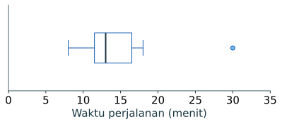

import RunnablePlot from '../../../components/RunnablePlot.astro';

Dua kelompok bisa memiliki rata-rata sama, tetapi tingkat keragamannya berbeda. Ukuran sebaran membantu melihat apakah nilai tipikal mewakili hampir semua pengamatan atau menutupi beberapa nilai yang jauh berbeda.

Untuk menjalankan contoh lengkap dengan pandas, unggah [CSV perjalanan](../../unduh-data/) ke Colab:

```python
import pandas as pd
data = pd.read_csv("perjalanan_contoh.csv")
waktu = data["waktu_menit"]
```

## Jangkauan menunjukkan kedua ujung

Daftar A: 18, 20, 22. Daftar B: 10, 20, 30. Keduanya memiliki rata-rata 20, tetapi jangkauannya berbeda.

`Jangkauan = nilai maksimum - nilai minimum`.

- Daftar A: `22 - 18 = 4` menit.
- Daftar B: `30 - 10 = 20` menit.

Jangkauan mudah dihitung, tetapi hanya melihat dua nilai. Ia dapat berubah besar karena satu nilai ekstrem.

## Kuartil dan IQR melihat separuh tengah

Urutkan data dari kecil ke besar. `Q1` menandai sekitar seperempat posisi terbawah, median menandai titik tengah, dan `Q3` menandai sekitar tiga perempat posisi. **IQR** adalah `Q3 - Q1`, rentang yang mencakup separuh tengah data.

Pada delapan waktu perjalanan `8, 10, 12, 12, 14, 16, 18, 30`, definisi interpolasi yang dipakai pandas memberi:

- `Q1 = 11,5` menit
- `Median = 13` menit
- `Q3 = 16,5` menit
- `IQR = 16,5 - 11,5 = 5` menit

Perangkat lunak dapat memakai aturan kuartil yang sedikit berbeda, terutama pada sampel kecil. Sebutkan cara hitung yang digunakan jika angka kuartil menjadi dasar keputusan.

## Varians dan simpangan baku

Varians merangkum kuadrat jarak setiap nilai dari mean. Varians sampel membagi jumlah kuadrat itu dengan `n - 1`. Simpangan baku adalah akar varians sehingga kembali ke satuan asal.

Untuk nilai `10, 20, 30`, mean-nya 20. Kuadrat selisih: `100, 0, 100`. Varians sampel adalah `(100 + 0 + 100) / (3 - 1) = 100`, maka simpangan baku `√100 = 10`.

```python
import statistics as st
print(st.variance([10, 20, 30]))
print(st.stdev([10, 20, 30]))
```

Keluaran: `100` lalu `10.0`.

Simpangan baku memakai semua nilai dan peka terhadap jarak jauh dari mean. IQR lebih tahan terhadap nilai ekstrem. Tidak ada ukuran yang selalu paling benar; pilih sesuai pertanyaan.

:::note[Data populasi atau sampel?]
Jika tabel berisi seluruh unit yang memang ingin dideskripsikan, varians populasi membagi jumlah kuadrat selisih dengan n. Jika data merupakan sampel yang dipakai untuk memperkirakan variasi populasi, varians sampel umumnya membagi dengan n − 1. Pandas memakai ddof=1 secara bawaan untuk std(); gunakan ddof=0 bila menghitung simpangan baku populasi. Nyatakan pilihan pembaginya.
:::

## Simpangan absolut rata-rata

Simpangan absolut rata-rata adalah rata-rata jarak absolut tiap pengamatan dari mean. Berbeda dari varians, jaraknya tidak dikuadratkan sehingga hasil tetap dalam satuan asal. Ia membantu menjelaskan “seberapa jauh nilai biasanya dari mean”, tetapi kurang umum dibandingkan simpangan baku dan IQR.

Untuk nilai 10, 20, 30, mean adalah 20. Jarak absolutnya 10, 0, dan 10; rata-ratanya 20/3 atau sekitar 6,67.

~~~python
nilai = [10, 20, 30]
pusat = sum(nilai) / len(nilai)
simpangan = [abs(x - pusat) for x in nilai]
print("Mean:", pusat)
print("Jarak absolut:", simpangan)
print("Simpangan absolut rata-rata:", sum(simpangan) / len(simpangan))
~~~

Baris pertama menyimpan tiga nilai. Baris kedua menghitung mean dengan jumlah dibagi banyak nilai. Perulangan ringkas membentuk jarak absolut setiap nilai dari mean; hasilnya 10, 0, 10. Baris terakhir menghitung rata-rata jarak tersebut. Bandingkan dengan simpangan baku sampel 10: kuadrat selisih membuat simpangan baku lebih peka pada jarak besar.

## Koefisien variasi untuk membandingkan skala

Koefisien variasi (CV) menyatakan simpangan baku sebagai persentase mean: CV = simpangan baku / mean × 100%. Ia berguna untuk membandingkan variasi relatif dua ukuran dengan skala berbeda, tetapi hanya ketika skala rasio memiliki nol bermakna dan mean positif serta tidak dekat nol.

~~~python
from statistics import mean, stdev

kelompok_a = [8, 10, 12]
kelompok_b = [45, 50, 55]
cv_a = stdev(kelompok_a) / mean(kelompok_a) * 100
cv_b = stdev(kelompok_b) / mean(kelompok_b) * 100
print("CV A (%):", round(cv_a, 1))
print("CV B (%):", round(cv_b, 1))
~~~

CV A sekitar 20%, sedangkan CV B sekitar 10%. Kelompok A lebih beragam relatif terhadap mean-nya; nilai mentah A dan B tidak berada pada tingkat yang sama. Jangan memakai CV pada suhu Celsius, kategori, mean nol, atau nilai yang dapat negatif. Dalam situasi tersebut, rasio simpangan terhadap mean tidak punya interpretasi yang aman.

## Hitung pada data contoh

```python
q1 = waktu.quantile(0.25)
q3 = waktu.quantile(0.75)
print("Minimum dan maksimum:", waktu.min(), waktu.max())
print("Jangkauan:", waktu.max() - waktu.min())
print("Q1, Q3, IQR:", q1, q3, q3 - q1)
print("Simpangan baku sampel:", round(waktu.std(), 2))
```

Keluaran:

```text
Minimum dan maksimum: 8 30
Jangkauan: 22
Q1, Q3, IQR: 11.5 16.5 5.0
Simpangan baku sampel: 6.85
```

`std()` di pandas memakai rumus simpangan baku sampel dengan penyebut `n - 1`. Data ini simulasi; hasilnya memperlihatkan cara kerja ukuran, bukan variasi waktu perjalanan sebuah kota.

## Boxplot dan tanda nilai untuk diperiksa

Boxplot menggambar Q1, median, Q3, whisker, dan titik yang melewati pagar aturan tertentu. Pagar atas IQR dihitung sebagai `Q3 + 1,5 × IQR`. Pada data ini, `16,5 + 1,5 × 5 = 24` menit. Nilai 30 melewati pagar, sehingga menjadi **kandidat untuk ditinjau**.

```python
import matplotlib.pyplot as plt
plt.boxplot(waktu, vert=False)
plt.xlabel("Waktu perjalanan (menit)")
plt.title("Delapan perjalanan simulasi")
plt.show()
```



Baris per baris:

| Kode | Fungsi |
|---|---|
| plt.boxplot(waktu, vert=False) | Menghitung kuartil dan menggambar kotak mendatar; vert=False membaringkannya agar skala waktu dibaca dari kiri ke kanan. |
| plt.xlabel(...) | Memberi nama dan satuan pada skala nilai. |
| plt.title(...) | Menjelaskan kumpulan yang diringkas oleh gambar. |
| plt.show() | Menampilkan gambar di notebook Colab. |

Kotak membentang dari Q1 sampai Q3; garis di kotak adalah median. Whisker menampilkan rentang nilai yang masih berada dalam aturan boxplot, dan titik di luarnya ditampilkan terpisah. Untuk aturan 1,5 × IQR, titik terpisah adalah **kandidat pemeriksaan**, bukan otomatis salah. Rujuk dokumentasi [boxplot Matplotlib](https://matplotlib.org/stable/gallery/statistics/boxplot_demo.html) bila ingin mengatur whisker atau menampilkan mean.

Untuk delapan nilai, tampilkan juga tabel mentah atau diagram titik. Boxplot meringkas dan dapat menyembunyikan rincian pengamatan.

:::caution[Nilai di luar pagar bukan otomatis salah]
Pagar adalah tanda untuk memeriksa, bukan batas kesalahan. Periksa formulir, alat ukur, satuan, dan konteks. Lihat [pencilan dan noise](../pencilan-noise/) sebelum memutuskan perlakuan.
:::

## Coba ubah satu nilai

Di lab berikut, ubah `30` menjadi `20`. Baca mean, median, IQR, dan pagar atas sebelum dan sesudah perubahan. Ini adalah **skenario kepekaan**, bukan petunjuk untuk menghapus nilai dari data asli.

Sebelum menjalankan lab, kenali bagian yang belum muncul di halaman sebelumnya: `quantiles(..., method="inclusive")` menghitung kuartil dengan interpolasi pada posisi; `nilai.copy()` membuat salinan supaya data awal tidak berubah; `skenario[-1]` memilih nilai terakhir; fungsi `ringkas` memakai parameter `label` dan `nilai`; daftar `kandidat` mengumpulkan nilai yang melewati pagar atas. Pada gambar, `plt.subplots` membuat satu Axes, `ax.boxplot` membandingkan dua daftar, dan `ax.axvline` menandai pagar awal sebagai garis acuan.

<RunnablePlot code={`import matplotlib
matplotlib.use("AGG")
from statistics import mean, median, quantiles
import matplotlib.pyplot as plt

waktu = [8, 10, 12, 12, 14, 16, 18, 30]
skenario = waktu.copy()
skenario[-1] = 20

def ringkas(label, nilai):
    q1, _, q3 = quantiles(nilai, n=4, method="inclusive")
    iqr = q3 - q1
    pagar_atas = q3 + 1.5 * iqr
    kandidat = [x for x in nilai if x > pagar_atas]
    print(label)
    print("  Mean:", round(mean(nilai), 2))
    print("  Median:", median(nilai))
    print("  Q1, Q3, IQR:", q1, q3, iqr)
    print("  Pagar atas:", pagar_atas)
    print("  Kandidat di atas pagar:", kandidat)

ringkas("Semua nilai", waktu)
ringkas("Skenario 30 menjadi 20", skenario)

fig, ax = plt.subplots(figsize=(7, 3.4))
ax.boxplot([waktu, skenario], vert=False)
ax.set_yticks([1, 2])
ax.set_yticklabels(["Semua nilai", "Skenario 30 → 20"])
ax.axvline(24, color="#c98216", linestyle="--", label="Pagar atas awal = 24")
ax.set_xlabel("Waktu perjalanan (menit)")
ax.legend()
fig.tight_layout()
fig.savefig("/tmp/statistik-plot.svg", format="svg", bbox_inches="tight")
`} title="Bandingkan sebaran" />

Perubahan satu angka dapat mengubah mean dan jangkauan lebih besar daripada median dan IQR. Pada contoh ini, nilai 30 juga berubah status relatif terhadap pagar. Catat skenario dengan jelas; jangan mengubah data utama tanpa bukti sumber.

## Pilih ukuran yang dibaca bersama

| Bentuk data dan tujuan | Pusat | Sebaran |
|---|---|---|
| Semua angka penting dan bentuk cukup simetris | Mean | Simpangan baku |
| Ada ekor panjang atau nilai ekstrem | Median | IQR |
| Data sangat sedikit | Tabel terurut | Minimum–maksimum dan grafik titik |

Mean dan simpangan baku tidak salah ketika ada nilai ekstrem; keduanya menjawab pertanyaan yang memakai semua jarak dari mean. Laporkan juga ukuran yang tahan jika pembaca perlu memahami waktu tipikal.

## Coba sendiri

Hitung mean dan jangkauan pada skenario tanpa baris 30 menit. Tulis bahwa tujuh nilai yang tersisa merupakan skenario. Apakah hasil itu cukup untuk menyatakan 30 adalah kesalahan?

<details>
<summary>Periksa pembahasan</summary>
<p>Tujuh nilai tersisa memiliki mean `12,86` menit dan jangkauan `10` menit. Ini menunjukkan pengaruh nilai 30, tetapi tidak membuktikan bahwa 30 salah. Periksa sumbernya dahulu.</p>
</details>

Lanjut ke [visualisasi data dengan Matplotlib](../visualisasi-deskriptif/) untuk melihat ukuran pusat, IQR, dan calon pencilan dalam bentuk grafik, kemudian kerjakan [uji praktik deskriptif](../cek-deskriptif/).
