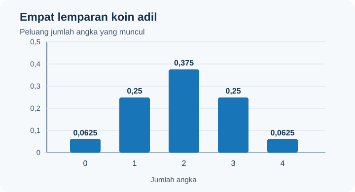
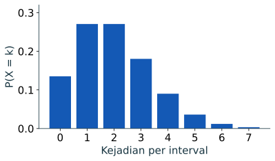
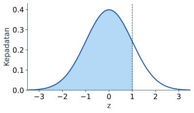
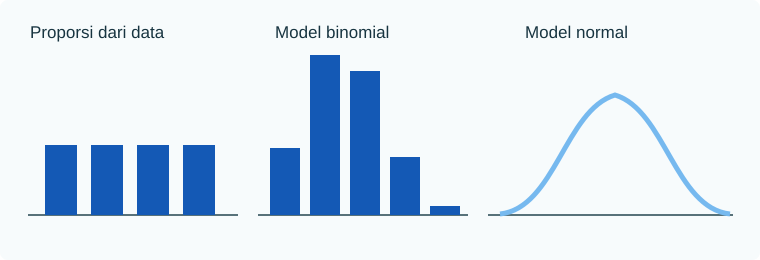

import RunnablePlot from '../../../components/RunnablePlot.astro';

Distribusi menunjukkan nilai apa saja yang mungkin dan seberapa sering atau seberapa besar peluang tiap nilai. Bayangkan kita mencatat waktu tunggu bus dalam menit. Daftar `[2, 3, 3, 4, 4, 4, 5, 8]` adalah distribusi empiris kecil: angka 4 muncul paling sering. Jika kita memakai model matematika, misalnya model normal, model itu menjelaskan pola yang mungkin dengan asumsi tertentu.

Data latihan berikut sengaja kecil dan dibuat untuk belajar membaca frekuensi. Data ini bukan hasil pengukuran halte sungguhan.

## Diskrit dan kontinu

Variabel acak adalah angka yang nilainya belum kita ketahui sebelum percobaan dilakukan. **Diskrit** berarti nilainya dapat dihitung satu per satu, seperti jumlah bus yang datang: 0, 1, 2, dan seterusnya. Tidak ada setengah bus. **Kontinu** berarti nilainya dapat berada di titik mana pun pada rentang, seperti waktu tunggu yang bisa 4 menit, 4,2 menit, atau 4,23 menit.

Untuk data diskrit, kita bisa bertanya, “berapa peluang jumlah bus tepat 2?” Untuk data kontinu, peluang tepat pada satu angka, misalnya tepat 4 menit, bernilai nol pada model matematis. Yang bermakna adalah peluang sebuah rentang, misalnya waktu tunggu antara 3 dan 5 menit.

| Istilah | Makna dengan kata sederhana |
|---|---|
| PMF, fungsi massa peluang | Daftar atau batang yang menunjukkan peluang pada setiap nilai hitungan, misalnya peluang mendapat 0, 1, atau 2 angka dari lemparan koin. |
| PDF, fungsi kepadatan | Garis kurva untuk nilai kontinu. Tinggi garis bukan peluang satu titik; luas di bawah kurva pada suatu rentanglah yang menjadi peluang rentang itu. |
| CDF, fungsi peluang kumulatif | Peluang yang dijumlahkan dari nilai paling kecil sampai batas tertentu. `P(X ≤ x)` berarti peluang nilai X paling banyak x. |

| Jenis | Pertanyaan | Cara memperoleh peluang |
|---|---|---|
| Diskrit | Tepat `k` kejadian | Tinggi batang PMF pada `k` |
| Kontinu | Antara `a` dan `b` | Luas di bawah PDF dari `a` ke `b` |
| Keduanya | Paling banyak `x` | CDF: seluruh peluang sampai `x` |

Nilai harapan `E(X)` adalah rata-rata jangka panjang menurut model, bukan ramalan tepat untuk satu percobaan. Untuk variabel diskrit, kita mengalikan setiap nilai dengan peluangnya lalu menjumlahkannya: `E(X) = Σ k P(X=k)`. Varians `Var(X) = E[(X-E(X))²]` merangkum seberapa menyebar nilai model dari rata-ratanya. Akar varians disebut simpangan baku dan memakai satuan yang sama dengan data.

## Distribusi empiris

Misalkan delapan waktu tunggu contoh yang dicatat adalah `[2, 3, 3, 4, 4, 4, 5, 8]` menit. Distribusi empirisnya dapat disajikan sebagai frekuensi:

```python
from collections import Counter

waktu_tunggu = [2, 3, 3, 4, 4, 4, 5, 8]
frekuensi = Counter(waktu_tunggu)
for menit, jumlah in sorted(frekuensi.items()):
    print(menit, "menit:", jumlah, "dari", len(waktu_tunggu))
```

Keluaran:

```text
2 menit: 1 dari 8
3 menit: 2 dari 8
4 menit: 3 dari 8
5 menit: 1 dari 8
8 menit: 1 dari 8
```

Semua frekuensinya berjumlah 8 karena setiap catatan masuk ke satu nilai waktu. Jika ingin proporsi, bagi setiap frekuensi dengan 8. Hasilnya merangkum delapan catatan latihan ini saja.

## Bernoulli: satu hasil ya atau tidak

Untuk satu percobaan dengan hasil “ya” atau “tidak”, model Bernoulli memberi peluang `p` pada “ya” dan `1-p` pada “tidak”. Contoh paling sederhana adalah satu lemparan koin adil: “ya” berarti angka muncul, sehingga `p = 0,5`; “tidak” berarti gambar muncul, sehingga peluangnya juga `0,5`.

## Binomial: jumlah hasil ya

Jika ada `n` percobaan dan hasil satu percobaan tidak mengubah peluang percobaan berikutnya, jumlah hasil ya `X` mengikuti model binomial. Peluang “ya” harus tetap `p` di setiap percobaan. `n` adalah jumlah percobaan dan `k` jumlah “ya” yang ingin dihitung. Rumusnya `P(X = k) = C(n,k) pᵏ (1-p)⁽ⁿ⁻ᵏ⁾`. Untuk empat lemparan koin adil dan tepat dua angka:

```python
from math import comb
p, n, k = 0.5, 4, 2
peluang = comb(n, k) * p**k * (1 - p)**(n - k)
print(round(peluang, 3))
```

Keluaran: `0.375`. `C(4,2)=6` menghitung posisi dua angka. Rata-rata model adalah `n × p`, yaitu 2 angka dari empat lemparan menurut model. Variansnya `n × p × (1-p)`. Jika percobaan berasal dari proses nyata, pastikan hasil satu percobaan tidak mengubah peluang percobaan berikutnya.

### Seluruh kemungkinan, bukan hanya satu nilai

```python
from math import comb
p, n = 0.5, 4
pmf = [comb(n, k) * p**k * (1-p)**(n-k) for k in range(n+1)]
for k, peluang in enumerate(pmf):
    print(k, round(peluang, 3))
print("P(X <= 2):", round(sum(pmf[:3]), 3))
print("E(X):", round(sum(k * peluang for k, peluang in enumerate(pmf)), 2))
```

Keluaran:

```text
0 0.062
1 0.25
2 0.375
3 0.25
4 0.062
P(X <= 2): 0.688
E(X): 2.0
```

Jumlah lima peluang adalah 1 (sebelum pembulatan). `P(X ≤ 2)` menjumlah batang pada 0, 1, dan 2; inilah CDF pada 2. Harapan 2 adalah rata-rata jangka panjang menurut model. Dalam satu rangkaian empat lemparan, jumlah angka yang benar-benar muncul tetap bilangan bulat 0 sampai 4.

```python
import matplotlib.pyplot as plt
plt.bar(range(5), pmf, color="#1459b5")
plt.xticks(range(5))
plt.xlabel("Banyak hasil ya dari 4 percobaan")
plt.ylabel("P(X = k)")
plt.show()
```



## Poisson: jumlah kejadian per interval

Poisson memodelkan banyak kejadian dalam suatu rentang waktu atau ruang. `λ` (lambda) adalah rata-rata kejadian per rentang. Contohnya, model menganggap rata-rata 2 kedatangan per menit. Jika laju relatif tetap dan kedatangan tidak datang bergerombol, peluang tepat satu kedatangan dapat dihitung dengan rumus `P(X = k) = e⁻λ λᵏ / k!`:

```python
from math import exp, factorial
lam, k = 2, 1
print(round(exp(-lam) * lam**k / factorial(k), 4))
```

Keluaran: `0.2707`. Ini peluang menurut model dengan `λ=2`, bukan hasil pengamatan lapangan. Bila laju berubah drastis menurut waktu atau kedatangan terjadi berkelompok, model sederhana dapat meleset.

```python
import matplotlib.pyplot as plt
peluang_k = [exp(-2) * 2**k / factorial(k) for k in range(8)]
plt.bar(range(8), peluang_k, color="#1459b5")
plt.xlabel("Kejadian per interval")
plt.ylabel("P(X = k)")
plt.show()
```



Grafik berhenti pada 7 agar terbaca; model Poisson tetap mengizinkan 8 atau lebih kejadian dengan peluang kecil. Jangan menormalisasi delapan batang seolah jumlahnya pasti 1.

## Uniform kontinu: peluang sebanding panjang

Pada model uniform antara 0 dan 10, tiap rentang dengan panjang sama mempunyai peluang sama. Kepadatannya `1/(10-0) = 0,1`. Peluang nilai antara 2 dan 4 adalah `2/10 = 0,2`.

```python
bawah, atas = 0, 10
print((4 - 2) / (atas - bawah))
```

Keluaran: `0.2`. Model ini bukan pernyataan bahwa semua waktu tunggu nyata tersebar uniform. Kita hanya menghitung peluang menurut model yang ditetapkan.

## Normal: kurva simetris

Model normal kontinu mempunyai mean `μ` dan simpangan baku `σ`. Skor baku `z = (x - μ) / σ` menyatakan jarak dari mean dalam satuan simpangan baku. Pada normal standar (`μ=0`, `σ=1`), peluang `Z ≤ 1` adalah sekitar 0,8413.

```python
from math import erf, sqrt
peluang_kumulatif = 0.5 * (1 + erf(1 / sqrt(2)))
print(round(peluang_kumulatif, 4))
```

Keluaran: `0.8413`. Angka ini adalah luas di bawah kurva di kiri 1, bukan tinggi kurva pada titik 1. Model normal memiliki bentuk simetris. Jangan memilihnya hanya karena perhitungan tersedia; lihat bentuk data, cara pengukuran, dan alasan substantifnya. Delapan pengamatan saja belum cukup untuk memastikan suatu populasi mengikuti distribusi normal.

```python
import numpy as np
import matplotlib.pyplot as plt
z = np.linspace(-3.5, 3.5, 300)
kepadatan = np.exp(-z**2 / 2) / np.sqrt(2 * np.pi)
plt.plot(z, kepadatan, color="#1459b5")
plt.fill_between(z, kepadatan, where=z <= 1, color="#76b9ef", alpha=0.6)
plt.axvline(1, color="#173440", linestyle="--")
plt.xlabel("z")
plt.ylabel("Kepadatan")
plt.show()
```



Luas arsir adalah `P(Z ≤ 1) ≈ 0,8413`. Untuk rentang, kurangi dua nilai CDF: `P(a < Z ≤ b) = F(b) - F(a)`. Sebagai pemeriksaan intuisi, pada model normal sekitar 68% nilai berada dalam satu simpangan baku dari mean dan sekitar 95% dalam dua simpangan baku. Aturan pendekatan itu **hanya** berlaku bila model normal layak digunakan.



## Pilih model dari prosesnya

| Pertanyaan | Model awal | Syarat penting |
|---|---|---|
| Apakah satu percobaan berhasil? | Bernoulli | Dua hasil dan `p` jelas |
| Berapa hasil ya dari `n` percobaan? | Binomial | `n` tetap, `p` tetap, percobaan independen |
| Berapa kejadian per interval? | Poisson | Laju relatif tetap dan kejadian tidak mengelompok kuat |
| Di mana nilai dalam suatu rentang? | Uniform | Kepadatan konstan pada rentang |
| Bagaimana nilai kontinu simetris di sekitar pusat? | Normal | Bentuk data dan konteks mendukung |

Histogram nilai yang diamati adalah **distribusi data**. Jika pengambilan sampel diulang berkali-kali dan setiap kali dihitung mean, kumpulan mean itu membentuk **distribusi sampling**. Yang kedua menjelaskan ketidakpastian statistik dan memerlukan rancangan sampel yang sah.

:::note[Model dan data]
Model menyatakan kemungkinan hasil di bawah asumsi tertentu. Data membantu memeriksa kecocokannya. Kecocokan bentuk grafik saja belum membuktikan semua asumsi.
:::

## Mini test

1. Ubah `k` binomial menjadi 1. Bandingkan peluangnya dengan tepat dua hasil ya.
2. Ubah `k` Poisson menjadi 0. Perkirakan hasilnya sebelum menjalankan.
3. Mengapa tinggi kurva normal pada satu titik tidak sama dengan peluang titik itu?

<details>
<summary>Periksa pembahasan</summary>
<p>Untuk binomial `k=1`, peluangnya `0.25`. Untuk Poisson dengan `λ=2`, peluang nol kejadian sekitar `0.1353`, lebih kecil daripada peluang tepat satu (`0.2707`). Pada model kontinu, peluang didapat dari <strong>luas rentang</strong> di bawah kurva; satu titik tidak mempunyai lebar sehingga peluangnya nol.</p>
</details>

## Dari populasi ke sampel

Distribusi data menggambarkan nilai yang tercatat. **Distribusi sampling** menggambarkan nilai suatu statistik—misalnya mean—jika proses mengambil sampel diulang berkali-kali dengan rancangan dan ukuran sampel yang sama. Distribusi sampling bukan histogram seluruh observasi, dan bukan distribusi probabilitas individu.

Cara memilih sampel harus mengikuti populasi dan pertanyaan:

| Cara | Bagaimana unit terpilih | Contoh kegunaan | Risiko yang perlu diperhatikan |
|---|---|---|---|
| Acak sederhana | Setiap unit dalam kerangka memiliki peluang terpilih yang sama | Memilih rumah dari daftar alamat lengkap | Kerangka yang tidak lengkap tetap menimbulkan bias cakupan. |
| Sistematis | Mulai dari titik acak, lalu pilih tiap unit ke-k | Memilih setiap rumah ke-10 pada daftar yang terurut | Pola periodik daftar dapat bertepatan dengan interval pemilihan. |
| Berstrata | Bagi populasi ke strata, lalu ambil sampel dari tiap strata | Memastikan tiap kelas ukuran wilayah tercakup | Jumlah sama per strata tidak otomatis mewakili proporsi populasi. |
| Klaster | Pilih sebagian kelompok, lalu amati unit dalam kelompok terpilih | Mengurangi biaya survei lapangan | Unit satu klaster sering mirip; sampel efektif dapat lebih kecil. |
| Kemudahan | Pilih unit yang mudah dijangkau | Uji coba kuesioner | Tidak memberi dasar kuat untuk generalisasi populasi. |

Sebelum menghitung, jelaskan populasi sasaran, kerangka sampel, unit sampel, cara pemilihan, waktu pengamatan, dan nonrespons. Ukuran sampel besar tidak menghapus bias pemilihan.

## Distribusi sampling mean dan Teorema Limit Tengah

Bayangkan populasi kecil [2, 4, 6, 8, 10]. Kita mengambil sampel berukuran 2 dengan pengembalian dan menghitung mean setiap sampel. Bila proses diulang banyak kali, mean sampel membentuk distribusi sampling. Rata-rata distribusi sampling berpusat di mean populasi pada rancangan ini; penyebarannya disebut galat baku mean.

Teorema Limit Tengah menjelaskan bahwa, di bawah syarat tertentu, distribusi sampling mean cenderung mendekati normal saat ukuran sampel membesar. **Tidak ada ambang 30 yang selalu menjamin pendekatan memadai.** Kemencengan kuat, pencilan, ketergantungan, dan populasi terbatas memengaruhi laju pendekatan.

<RunnablePlot title="Lab distribusi sampling mean" code={`import matplotlib
matplotlib.use("AGG")
import numpy as np
import matplotlib.pyplot as plt

populasi = np.array([2, 4, 6, 8, 10])
rng = np.random.default_rng(24)
banyak_sampel = 3000
ukuran = 2
sampel = rng.choice(populasi, size=(banyak_sampel, ukuran), replace=True)
mean_sampel = sampel.mean(axis=1)

print("Mean populasi:", round(float(populasi.mean()), 2))
print("Mean dari seluruh mean sampel:", round(float(mean_sampel.mean()), 2))
print("Simpangan baku mean sampel:", round(float(mean_sampel.std()), 2))

fig, ax = plt.subplots(figsize=(7, 4))
ax.hist(mean_sampel, bins=9, color="#1876b8", edgecolor="white")
ax.axvline(populasi.mean(), color="#d49b18", linestyle="--",
           label="Mean populasi")
ax.set_title("Distribusi mean dari sampel berukuran 2")
ax.set_xlabel("Mean sampel")
ax.set_ylabel("Frekuensi simulasi")
ax.legend()
fig.tight_layout()
fig.savefig("/tmp/statistik-plot.svg")
`} />

Kode membuat 3.000 sampel acak, tiap sampel berisi dua nilai. `axis=1` berarti hitung mean melintasi kolom pada setiap baris sampel. Hasil simulasi berubah bila seed atau banyak pengulangan berubah; mean sampel berkumpul di sekitar mean populasi 6. Coba ubah `ukuran` menjadi 4 dan bandingkan lebar histogram. Simulasi ini mengilustrasikan konsep, tidak mengganti desain sampel yang benar.

## Uji pemahaman

1. Jumlah kerusakan per minggu: variabel diskrit atau kontinu? Model mana yang mungkin dipertimbangkan jika kejadian jarang dan lajunya stabil?
2. Waktu tunggu dapat mengambil nilai pecahan. Untuk variabel kontinu, bagaimana menghitung peluang antara 5 dan 10 menit?
3. Apa perbedaan distribusi nilai individu dan distribusi sampling mean?
4. Mengapa sampel acak sederhana dari daftar pelanggan dapat tetap bias bila daftar tidak mencakup semua warga?
5. Apakah ukuran sampel 30 otomatis membuat distribusi sampling normal?

<details>
<summary>Pembahasan</summary>
<p>1. Diskrit; Poisson dapat dipertimbangkan jika laju relatif tetap dan kejadian tidak mengelompok kuat. 2. Luas di bawah PDF antara batas atau selisih CDF, bukan tinggi kurva pada satu titik. 3. Yang pertama merangkum nilai unit; yang kedua merangkum statistik dari banyak sampel berulang. 4. Sebagian populasi tidak berpeluang masuk karena tidak tercantum pada kerangka. 5. Tidak; bentuk populasi, pencilan, ketergantungan, dan ukuran sampel ikut berpengaruh.</p>
</details>

## Kesimpulan

Distribusi adalah model untuk kemungkinan nilai, sedangkan distribusi sampling menerangkan variasi statistik antarsampel. Bernoulli/binomial sesuai hitungan hasil ya/tidak, Poisson untuk hitungan kejadian pada interval dengan asumsi laju, dan normal untuk besaran kontinu ketika bentuk dan konteks mendukung. Sampling harus diawali dengan populasi serta kerangka yang jelas. Gunakan model untuk menjawab pertanyaan di bawah asumsi yang dituliskan, lalu periksa asumsi itu terhadap data dan rancangan.

Lanjut ke [peluang melalui simulasi](../simulasi-peluang/) untuk melihat apa yang terjadi ketika model dijalankan berulang kali.
