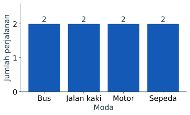
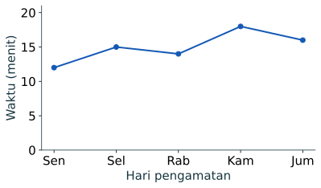
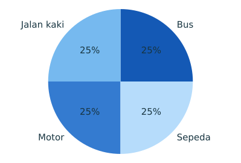
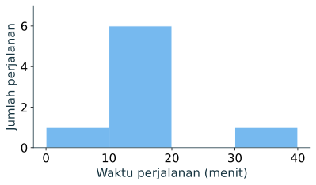
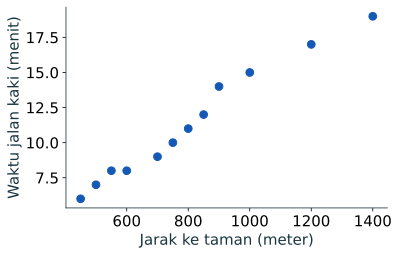

import RunnablePlot from '../../../components/RunnablePlot.astro';

Grafik yang baik menjawab satu pertanyaan dengan jenis sumbu yang sesuai. Galeri dan panduan ini telah disatukan ke [visualisasi data dengan Matplotlib](../visualisasi-deskriptif/), setelah ukuran pemusatan dan penyebaran, agar aturan membaca serta praktik menggambar tidak terpisah-pisah.

```python
import pandas as pd
import matplotlib.pyplot as plt

data = pd.read_csv("perjalanan_contoh.csv")
taman = pd.read_csv("akses_taman_latihan.csv")
warna = "#1459b5"
```

## Kategori: diagram batang

Empat moda adalah kategori nominal. Panjang batang mewakili **jumlah**, dan sumbu jumlah dimulai dari nol.

```python
jumlah = data["moda"].value_counts().sort_index()
print(jumlah.to_string())
jumlah.plot.bar(color=warna)
for i, nilai in enumerate(jumlah.values):
    plt.text(i, nilai + 0.06, str(nilai), ha="center")
plt.ylabel("Jumlah perjalanan")
plt.xlabel("Moda")
plt.ylim(0, 2.6)
plt.tight_layout()
plt.show()
```

Keluaran angka: setiap kategori muncul `2` kali. Hasil visual:



**Baca grafik:** semua kategori sama banyak pada delapan baris ini. Batang tidak membuktikan proporsi moda di populasi. Jika label panjang, diagram batang mendatar dapat lebih mudah dibaca: `jumlah.plot.barh()`.

Pada kode tersebut, `value_counts()` menghitung baris per kategori dan `sort_index()` mengurutkan nama kategori. `plot.bar()` menggambar frekuensi; perulangan `for` memberi nomor posisi dan nilainya untuk diletakkan oleh `plt.text()` di atas batang. Label sumbu memberi satuan hitungan. `tight_layout()` mengurangi risiko label terpotong.

## Lab Python interaktif

Sekarang ubah tinggi batang, warna, atau judul grafik. Sebelum menekan tombol, prediksi perubahan yang akan terlihat. Sesudah grafik muncul, periksa kembali apakah sumbu Y masih dimulai dari nol dan apakah judulnya masih sesuai dengan angka yang Anda masukkan.

<RunnablePlot code={`import matplotlib
matplotlib.use("AGG")
import matplotlib.pyplot as plt

moda = ["Bus", "Motor", "Jalan kaki", "Sepeda"]
jumlah_perjalanan = [2, 2, 2, 2]

fig, ax = plt.subplots(figsize=(6, 3.5))
ax.bar(moda, jumlah_perjalanan, color="#1459b5")
ax.set_title("Jumlah perjalanan per moda")
ax.set_xlabel("Moda")
ax.set_ylabel("Jumlah perjalanan")
ax.set_ylim(0, 3)
fig.tight_layout()
fig.savefig("/tmp/statistik-plot.svg", format="svg", bbox_inches="tight")
`} title="Ubah diagram batang" />

:::note[Latihan pertama]
Ubah `jumlah_perjalanan` menjadi `[1, 3, 2, 4]`. Setelah grafik muncul, tulis kategori dengan jumlah tertinggi dan terendah. Jangan mengubah sumbu Y menjadi selain jumlah perjalanan.
:::

## Urutan waktu: diagram garis

Diagram garis menghubungkan pengamatan yang **punya urutan waktu**. Contoh lima hari berikut dibuat terpisah dari CSV perjalanan karena CSV itu tidak memiliki tanggal.

```python
harian = pd.Series([12, 15, 14, 18, 16], index=["Sen", "Sel", "Rab", "Kam", "Jum"])
print(harian.to_string())
harian.plot.line(marker="o", color=warna)
plt.ylabel("Waktu (menit)")
plt.xlabel("Hari pengamatan")
plt.ylim(0, 21)
plt.tight_layout()
plt.show()
```

Keluaran: `Sen 12`, `Sel 15`, `Rab 14`, `Kam 18`, `Jum 16` menit.



**Baca grafik:** tertinggi Kamis, tetapi lima titik tidak cukup untuk menyatakan tren jangka panjang. Menghubungkan kategori moda dengan garis akan menyiratkan urutan yang tidak ada.

Di sini `pd.Series(...)` membentuk deret nilai dengan indeks nama hari. `plot.line(marker="o")` menghubungkan nilai sesuai urutan indeks dan menandai setiap pengamatan; `ylim(0, 21)` menjaga sumbu tetap mulai dari nol. Untuk tanggal yang terlewat, periksa jarak waktunya sebelum menafsirkan kemiringan garis.

## Bagian dari keseluruhan: diagram lingkaran

Diagram lingkaran memakai proporsi dari **satu keseluruhan**. Jumlah semua sektor harus 100% dan kategorinya saling terpisah.

```python
jumlah.plot.pie(
    autopct="%1.0f%%", ylabel="",
    colors=["#1459b5", "#76b9ef", "#347bd0", "#b6dcfb"],
)
plt.axis("equal")
plt.show()
```

Keluaran: empat sektor masing-masing `25%`.



Untuk membandingkan kategori dengan presisi, diagram batang atau tabel lebih mudah. Hindari lingkaran bila kategori banyak, selisih kecil, atau kategorinya tumpang tindih.

`plot.pie()` mengubah tiap frekuensi menjadi bagian dari total. `autopct` menulis persentase pada sektor, `ylabel=""` menghilangkan label sumbu yang tidak berguna pada bentuk lingkaran, dan `axis("equal")` menjaga bidang gambar tetap persegi sehingga lingkaran tidak menjadi oval.

## Satu besaran: diagram titik dan histogram

Diagram titik mempertahankan tiap nilai. Histogram menggabungkannya ke interval, sehingga cocok ketika baris lebih banyak. Untuk delapan nilai, lihat keduanya.

```python
waktu = data["waktu_menit"].sort_values().reset_index(drop=True)
print(waktu.tolist())
plt.scatter(waktu, range(1, len(waktu) + 1), color=warna)
plt.xlabel("Waktu perjalanan (menit)")
plt.ylabel("Urutan nilai")
plt.show()
```

Keluaran: `[8, 10, 12, 12, 14, 16, 18, 30]`.

`sort_values()` mengurutkan nilai, sedangkan `reset_index(drop=True)` memberi indeks baru 0, 1, 2, dan seterusnya setelah pengurutan. `scatter(x, y)` menggambar satu titik pada setiap pasangan nilai; di sini nomor urut hanya membantu memisahkan titik, bukan variabel hasil pengukuran.


```python
data["waktu_menit"].plot.hist(bins=[0, 10, 20, 30, 40], color="#76b9ef", edgecolor="white")
plt.xlabel("Waktu perjalanan (menit)")
plt.ylabel("Jumlah perjalanan")
plt.show()
```

Keluaran jumlah per rentang: `[0,10)` = 1; `[10,20)` = 6; `[20,30)` = 0; `[30,40]` = 1.



Lebar rentang mengubah kesan visual. Jangan memilih batas hanya agar pola sesuai dugaan. Pada rentang terakhir, nilai 30 masuk ke `[30,40]`.

Argumen `bins` memberi batas interval, bukan jumlah batang. `edgecolor` menggambar tepi terang agar batas batang yang berdekatan terlihat. `plot.hist()` menghitung frekuensi tiap rentang; sumbu Y karena itu menunjukkan jumlah, bukan nilai waktu.

## Lima angka ringkas: boxplot

Boxplot memadatkan median, kuartil, whisker, dan kandidat pencilan. Ia bukan pengganti tabel mentah ketika `n` kecil.

```python
plt.boxplot(data["waktu_menit"], vert=False)
plt.xlabel("Waktu perjalanan (menit)")
plt.show()
```


Kotak membentang dari `Q1 = 11,5` ke `Q3 = 16,5`, garis di dalamnya median `13`. Aturan whisker Matplotlib menandai 30 sebagai kandidat pencilan karena melewati pagar atas 24. Titik ini **belum** boleh dianggap salah. Lihat [pencilan dan noise](../pencilan-noise/) untuk keputusan berikutnya.

`boxplot()` merangkum kuartil dan whisker dari kolom waktu. `vert=False` menempatkan skala waktu dari kiri ke kanan; `xlabel()` lalu menerangkan besaran dan unitnya. Karena hanya delapan nilai, gunakan daftar terurut atau diagram titik sebagai pendamping.

## Dua besaran: diagram pencar

Diagram pencar memerlukan dua variabel numerik pada unit yang sama. Dataset taman memuat 12 zona simulasi; contoh ini lebih kaya daripada data perjalanan terpandu.

```python
print("Zona:", len(taman))
plt.scatter(taman["jarak_meter"], taman["jalan_kaki_menit"], color=warna)
plt.xlabel("Jarak ke taman (meter)")
plt.ylabel("Waktu jalan kaki (menit)")
plt.show()
```

Keluaran: `Zona: 12`.



Setiap titik adalah satu zona, bukan satu individu. Pola naik menunjukkan bahwa zona lebih jauh cenderung membutuhkan waktu lebih lama dalam data simulasi; ia tidak membuktikan jarak sebagai satu-satunya penyebab. Periksa rute, kecepatan, dan kondisi trotoar sebelum menafsirkan hubungan.

Pada pencar, argumen pertama adalah sumbu X (jarak) dan kedua sumbu Y (waktu); pastikan panjang kedua kolom sama sehingga satu titik tetap mewakili satu zona. Label kedua sumbu harus menyertakan unit. Warna di sini hanya membedakan semua titik dari latar, bukan menyatakan kategori tambahan.

## Peta keputusan singkat

| Variabel dan pertanyaan | Grafik awal | Periksa sebelum menyimpulkan |
|---|---|---|
| Satu kategori: mana paling banyak? | Batang | Kategori hilang, penyebut, sumbu nol |
| Bagian dari satu total? | Lingkaran bila kategori sedikit | Jumlah tepat 100%, tidak tumpang tindih |
| Satu besaran: bagaimana sebarannya? | Titik, histogram, boxplot | Satuan, rentang, `n`, nilai ekstrem |
| Besaran menurut waktu? | Garis | Urutan, jarak antartitik, jeda |
| Dua besaran per unit? | Pencar | Unit yang sama, pencilan, pengelompokan |

## Mini test

1. Anda punya jumlah penduduk menurut lima kecamatan pada tahun yang sama. Pilih batang atau garis. Mengapa?
2. Anda punya suhu tiap jam selama sehari. Pilih garis atau lingkaran. Mengapa?
3. Jika satu nilai 30 menit dihapus dari boxplot, apa yang hilang dari cerita data?

<details>
<summary>Periksa pembahasan</summary>
<p>Batang cocok untuk lima kategori kecamatan; garis menyiratkan urutan waktu yang tidak ada. Garis cocok untuk suhu per jam karena urutannya bermakna. Menghapus 30 menghilangkan bukti bahwa satu perjalanan jauh lebih lama daripada sebagian besar lainnya; tindakan itu memerlukan alasan dari sumber, bukan dari bentuk kotak.</p>
</details>
