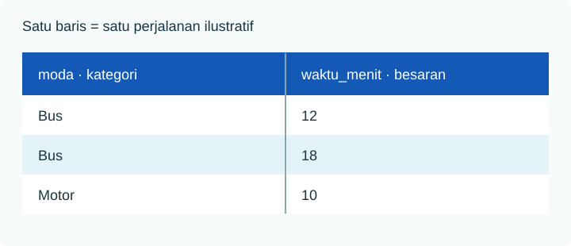

Pertanyaan **“berapa lama perjalanan?”** terdengar sederhana. Jawabannya berubah jika satu baris adalah perjalanan, orang, atau rata-rata sebuah zona. Karena itu, tentukan unit analisis sebelum memilih rumus.

Pada [data contoh](../../unduh-data/), satu baris adalah satu perjalanan ilustratif. Kolom `moda` mencatat kategori, sedangkan `waktu_menit` mencatat besaran. Data ini tidak menyebut kota, tanggal, atau cara memilih perjalanan.

Untuk menjalankan contoh pada halaman ini, unggah CSV lalu buat tabel:

```python
import pandas as pd
data = pd.read_csv("perjalanan_contoh.csv")
```



## Dari pertanyaan ke tabel

Satu **observasi** adalah catatan untuk satu unit. **Variabel** adalah ciri yang dicatat berulang pada unit tersebut. **Nilai** adalah isi satu sel. Pada tabel perjalanan, unitnya perjalanan, variabelnya `moda` dan `waktu_menit`, dan nilai `18` berarti 18 menit pada satu perjalanan.

Sebelum menghitung, jawab empat hal: siapa atau apa unitnya, kapan dicatat, dari mana diperoleh, dan apakah satu baris dapat muncul lebih dari sekali. Dua perjalanan orang yang sama dapat menjadi dua observasi, tetapi tidak sama dengan dua orang independen.

## Deskriptif, inferensi, dan parameter

Statistik **deskriptif** merangkum data yang tersedia, misalnya median delapan waktu. Statistik **inferensial** memakai sampel dan asumsi untuk menaksir atau menguji sesuatu tentang populasi. Rata-rata sampel sering ditulis `x̄`, sedangkan rata-rata populasi `μ`. Menyebut tabel kecil sebagai “sampel” belum cukup: cara pemilihannya menentukan seberapa jauh hasil bisa digeneralisasi.

:::caution[Data simulasi]
Delapan baris di sini dibuat untuk belajar. Rata-rata 15 menit adalah ringkasan tabel, bukan taksiran waktu perjalanan suatu kota.
:::

## Skala menentukan ringkasan

- `moda` adalah nominal. Urutan Bus, Motor, Jalan kaki, Sepeda tidak memiliki arti matematis. Hitung frekuensinya.
- `waktu_menit` adalah rasio. Selisih, rata-rata, dan sebarannya dapat ditafsirkan bersama satuan.
- Pada [data akses taman](../../unduh-data/), `kondisi_trotoar` adalah ordinal: Kurang, Cukup, Baik. Urutannya jelas, tetapi jarak antara kategori belum tentu setara.

Skala interval berbeda dari rasio. Contoh suhu Celsius: selisih 20°C dan 10°C adalah 10°C, tetapi 20°C tidak berarti dua kali lebih panas daripada 10°C.

**Diskrit** dan **kontinu** menjelaskan sifat nilai numerik. Jumlah kendaraan biasanya bilangan cacah (diskrit). Waktu dapat diukur semakin rinci (kontinu secara konseptual), meski berkas ini membulatkannya ke menit. Kode pos dan nomor identitas tampak numerik, tetapi fungsinya label, bukan besaran untuk dirata-ratakan.

| Variabel | Jenis | Skala | Ringkasan awal |
|---|---|---|---|
| Moda | Kategori | Nominal | Frekuensi |
| Kondisi trotoar | Kategori | Ordinal | Frekuensi menurut urutan |
| Suhu Celsius | Numerik | Interval | Pusat dan selisih |
| Waktu tempuh | Numerik | Rasio | Pusat, sebaran, grafik |

### Uji empat skala dengan pertanyaan yang tepat

| Skala | Apakah kategori berbeda? | Ada urutan? | Selisih sama bermakna? | Nol berarti tidak ada besaran? | Contoh |
|---|---|---|---|---|---|
| Nominal | Ya | Tidak | Tidak | Tidak | Moda: Bus, Motor, Sepeda |
| Ordinal | Ya | Ya | Belum tentu | Tidak | Penilaian: Kurang, Cukup, Baik |
| Interval | Ya | Ya | Ya | Tidak | Suhu Celsius, tahun kalender |
| Rasio | Ya | Ya | Ya | Ya | Waktu, jarak, jumlah kendaraan |

**Tes cepat:** Apakah 20 benar-benar dua kali 10? Untuk jarak 20 km dan 10 km, ya. Untuk suhu 20°C dan 10°C, tidak, sebab 0°C bukan “tidak ada suhu”. Apakah nilai 4 pada skala kepuasan dua kali nilai 2? Tidak ada dasar untuk menyatakannya; angka itu mengkode urutan tanggapan.

Angka yang dicetak pada kolom tidak menentukan skala. Kode wilayah `101`, `102`, `103` tetap nominal; mean kode wilayah tidak mempunyai arti. Satu butir penilaian 1–5 pada umumnya diperlakukan sebagai ordinal. Analisis skor gabungan dari beberapa butir memerlukan penjelasan tambahan tentang konstruksi skala; jangan otomatis menganggap setiap jarak antarnilai setara.

### Jenis nilai dan jenis berkas berbeda

`waktu_menit` adalah variabel numerik rasio; dalam Python, kolomnya dapat terbaca `int64` karena seluruh angka ditulis bulat. Itu **tipe penyimpanan**, bukan skala pengukuran. Durasi tetap konseptual kontinu meskipun alat membulatkan ke menit. Sebaliknya, nomor zona bisa tersimpan sebagai bilangan bulat, tetapi tetap nominal.

```python
print(data.dtypes.to_string())
print("Jumlah moda berbeda:", data["moda"].nunique())
```

Keluaran pada CSV contoh:

```text
moda            object
waktu_menit      int64
Jumlah moda berbeda: 4
```

Keluaran `dtypes` dapat menampilkan nama tipe teks yang sedikit berbeda antarversi pandas. Makna statistiknya tetap perlu ditetapkan dari kamus data, bukan dari `dtypes` saja.

## Bentuk data menurut waktu

Data **lintas bagian** (*cross-sectional*) membandingkan unit dalam satu periode. **Deret waktu** mencatat variabel yang sama pada beberapa waktu. **Panel** mengikuti unit yang sama dari waktu ke waktu. Dalam panel, dua baris zona yang sama pada tahun berbeda tidak boleh dianggap dua zona berbeda. Data perjalanan contoh tidak menyertakan tanggal, sehingga tidak dapat dipakai untuk membaca tren.

Data juga dapat berupa **rekaman kejadian**: satu baris per perjalanan, transaksi, atau kunjungan. Beberapa baris bisa berasal dari orang yang sama. Jika yang dianalisis adalah orang, data kejadian perlu diringkas terlebih dahulu atau dianalisis dengan rancangan yang mengakui pengulangan. Menghitung delapan perjalanan sebagai delapan orang akan mengubah penyebut dan kesimpulan.

## Bedakan populasi, sampel, statistik, dan parameter

Misalkan pertanyaannya adalah waktu perjalanan **seluruh** penumpang pada satu koridor selama September. Itulah populasi yang dibatasi tempat, waktu, dan jenis unit. Jika kita memilih 100 perjalanan menurut rancangan tertentu, 100 itu adalah sampel. Mean dari 100 perjalanan adalah **statistik sampel** (`x̄`); mean seluruh perjalanan koridor adalah **parameter populasi** (`μ`). Statistik dapat dipakai untuk menaksir parameter hanya jika cara pemilihan dan sumber kesalahannya dipahami.

Delapan baris ilustratif tidak diambil dari koridor nyata. Karena itu, `x̄ = 15` menit di sini adalah ringkasan data buatan, bukan taksiran `μ` suatu koridor.

## Lihat data sebelum menghitung

Jalankan kode ini setelah membaca CSV:

```python
print(data["moda"].value_counts().to_string())
```

Keluaran:

```text
moda
Bus           2
Motor         2
Jalan kaki    2
Sepeda        2
```

Baris pada keluaran menghitung kategori, bukan kualitas layanan. Mengetahui jumlah Bus dan Motor sama tidak cukup untuk menyatakan keduanya sama baik. Data ini juga tidak mempunyai rancangan pemilihan sampel.

:::note[Populasi dan sampel]
Populasi adalah seluruh unit yang menjadi sasaran pertanyaan, misalnya semua perjalanan pada koridor tertentu selama satu bulan. Sampel adalah sebagian unit yang dipilih dari populasi itu. Sebuah tabel kecil belum otomatis menjadi sampel yang mewakili populasi.
:::

## Coba sendiri

1. Jika satu baris berubah menjadi satu **rumah tangga**, apakah `waktu_menit` masih jelas artinya? Tulis definisi baru yang diperlukan.
2. Manakah yang masuk akal: rata-rata nomor urut baris, frekuensi `moda`, atau median `waktu_menit`? Jelaskan alasannya.
3. Ubah `"moda"` pada kode menjadi `"waktu_menit"`. Mengapa keluaran `value_counts()` kini kurang cocok sebagai ringkasan utama?
4. Sebuah tabel memiliki kolom `tahun`, `zona`, dan `jumlah_penduduk`, dengan satu baris per zona per tahun. Apakah satu baris mewakili zona atau pasangan zona-tahun? Mengapa perbedaan itu penting?

<details><summary>Periksa pembahasan</summary>

Satu rumah tangga dapat melakukan banyak perjalanan, sehingga perlu definisi seperti “lama perjalanan kerja anggota rumah tangga yang dipilih”. Frekuensi moda dan median waktu sesuai skalanya; rata-rata nomor urut baris tidak. Untuk waktu, frekuensi setiap angka sering kurang informatif daripada pusat, sebaran, dan grafik karena waktu adalah besaran kuantitatif. Pada tabel penduduk, satu baris mewakili pasangan zona-tahun. Zona yang sama dapat hadir pada tahun berbeda; banyak baris tidak sama dengan banyak zona unik.

</details>
