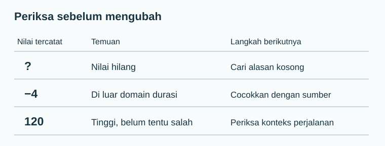

Data yang dapat dibaca Python belum tentu siap dianalisis. Sebelum menghitung rata-rata, tanyakan apakah setiap baris mewakili unit yang benar, setiap kolom memiliki definisi yang tetap, dan setiap nilai masuk akal menurut cara pengukurannya.

## Lima pemeriksaan awal

| Pemeriksaan | Pertanyaan | Contoh masalah | Tindakan awal |
|---|---|---|---|
| Struktur | Apakah satu baris benar-benar satu unit? | Satu responden tercatat dua kali | Periksa pengenal dan waktu, jangan langsung hapus |
| Kelengkapan | Mengapa sel kosong? | Waktu tidak diisi | Bedakan tidak ditanya, menolak, dan tidak berlaku |
| Validitas | Apakah nilai berada dalam domain yang mungkin? | Durasi `-5` menit | Cocokkan formulir atau sumber mentah |
| Konsistensi | Apakah label dan satuan seragam? | `bus`, `Bus`, `BUS`; menit bercampur jam | Standarkan dengan aturan tertulis |
| Ketepatan | Apakah angka dekat dengan besaran sebenarnya? | Sensor selalu lebih tinggi 3°C | Periksa kalibrasi; angka tampak rapi pun bisa bias |

**Akurasi** berarti dekat dengan nilai sebenarnya; **presisi** berarti hasil pengukuran berulang saling berdekatan. Alat yang selalu meleset 3 satuan bisa presisi tetapi tidak akurat. Kelengkapan seratus persen juga tidak menjamin akurasi.

## Contoh kecil: tabel yang perlu diperiksa

Tabel berikut dibuat khusus untuk latihan. Tanda `?` berarti belum diketahui, bukan nol.

| id | moda | waktu_menit | Catatan awal |
|---|---|---:|---|
| P1 | Bus | 12 | Masuk akal |
| P2 | bus | 18 | Penulisan kategori berbeda |
| P3 | Motor | ? | Alasan kosong belum diketahui |
| P4 | Sepeda | -4 | Durasi negatif tidak sah |
| P4 | Sepeda | -4 | Baris tampak duplikat |
| P5 | Jalan kaki | 120 | Tinggi, tetapi mungkin sah |



Jika langsung menghitung mean, Python dapat gagal karena `?`, atau memberi angka yang menyesatkan setelah `?` dipaksa menjadi nol. Baris 120 menit berbeda dari `-4`: yang pertama perlu diperiksa konteksnya, yang kedua melanggar definisi durasi. Duplikat P4 dapat merupakan pengiriman ulang atau perjalanan kedua yang kebetulan berkode sama; perlu identitas kejadian untuk memutuskan.

## Audit dengan pandas

Kode ini membangun tabel latihan di memori. Ia tidak mengubah [CSV perjalanan utama](../../unduh-data/).

```python
import pandas as pd

mentah = pd.DataFrame({
    "id": ["P1", "P2", "P3", "P4", "P4", "P5"],
    "moda": ["Bus", "bus", "Motor", "Sepeda", "Sepeda", "Jalan kaki"],
    "waktu_menit": ["12", "18", "?", "-4", "-4", "120"],
})
print("Ukuran:", mentah.shape)
print("Kategori:", sorted(mentah["moda"].unique()))
print("Duplikat persis:", mentah.duplicated().sum())
angka = pd.to_numeric(mentah["waktu_menit"], errors="coerce")
print("Tidak terbaca sebagai angka:", angka.isna().sum())
print("Durasi negatif:", (angka < 0).sum())
```

Keluaran:

```text
Ukuran: (6, 3)
Kategori: ['Bus', 'Jalan kaki', 'Motor', 'Sepeda', 'bus']
Duplikat persis: 1
Tidak terbaca sebagai angka: 1
Durasi negatif: 2
```

`errors="coerce"` menandai `?` sebagai nilai hilang pada **salinan hasil konversi**, bukan memperbaiki sumbernya. Dua durasi negatif berasal dari dua baris P4 yang identik. Jangan menyebutnya dua kesalahan pengukuran independen sebelum status duplikat dipastikan.

:::caution[Urutan keputusan penting]
Jika duplikat benar-benar pengiriman ulang, satu baris dapat dibuang dengan alasan itu. Jika `-4` kemudian dikonfirmasi salah ketik untuk `14`, koreksi berdasarkan sumber. Jika sumber tidak ada, tandai sebagai tidak valid; jangan menebak 14 hanya karena tampak masuk akal.
:::

## Nilai hilang: apa yang boleh disimpulkan?

Nilai hilang dapat terjadi karena formulir terlewat, pertanyaan tidak berlaku, sensor rusak, atau responden tertentu lebih sering tidak menjawab. Penyebab terakhir dapat membuat baris lengkap berbeda dari baris tidak lengkap. Karena itu, menghitung mean hanya pada baris lengkap perlu menyebutkan berapa baris yang tersisa dan siapa yang terbuang.

```python
bersih_sementara = mentah.assign(
    moda=mentah["moda"].replace({"bus": "Bus"}),
    waktu_menit=angka,
)
print(bersih_sementara.isna().sum().to_string())
print("Baris dengan waktu terisi:", bersih_sementara["waktu_menit"].notna().sum())
```

Keluaran:

```text
id              0
moda            0
waktu_menit     1
Baris dengan waktu terisi: 5
```

Mengisi semua nilai kosong dengan mean terlihat praktis, tetapi membuat variasi tampak lebih kecil dan dapat menggeser hubungan antarkolom. Untuk latihan kecil ini, laporkan satu nilai hilang dan cari penyebabnya. Jika analisis nyata memerlukan imputasi, jelaskan asumsi, metode, dan analisis kepekaan; jangan menyamarkannya sebagai pengamatan asli.

## Jejak pembersihan

Simpan `mentah` dan buat variabel baru untuk perubahan. Catat: aturan, jumlah baris terdampak, alasan, dan hasil sebelum–sesudah. Contoh catatan: “Label `bus` menjadi `Bus` karena kamus kategori menetapkan satu ejaan; satu dari enam baris berubah.” Catatan ini memungkinkan orang lain mengulang keputusan, termasuk menolaknya.

## Mini test

1. Mengapa nilai kosong tidak sama dengan nol menit?
2. Apakah `120` harus dihapus karena jauh lebih besar daripada 12 dan 18?
3. Pada contoh, apakah `drop_duplicates()` aman sebelum kita tahu apakah P4 dapat mewakili dua perjalanan?

<details><summary>Periksa pembahasan</summary>

Nol menyatakan durasi yang terukur nol; kosong menyatakan durasi tidak diketahui atau tidak berlaku. Nilai 120 perlu ditelusuri, bukan otomatis dihapus. Dua baris P4 identik secara teknis, tetapi keputusan menghapusnya memerlukan definisi pengenal perjalanan. Bila P4 adalah pengenal orang, orang itu mungkin memang membuat dua perjalanan; tambahkan pengenal kejadian atau waktu sebelum memutuskan.

</details>

Berikutnya: [pencilan dan noise](../pencilan-noise/).
