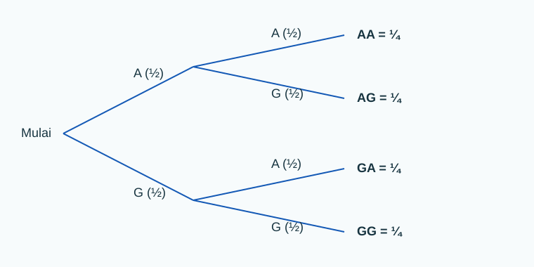

import RunnablePlot from '../../../components/RunnablePlot.astro';

Peluang bertahap dipakai saat satu kejadian terdiri dari beberapa langkah, seperti melempar koin dua kali atau mengambil dua kartu dari kantong. Kita ikuti urutannya supaya setiap perubahan peluang terlihat.

Saat ada beberapa langkah, peluang tiap langkah bisa berubah. Karena itu, jangan langsung memakai angka yang sama berulang kali. Tanyakan dulu: apa yang sudah terjadi, dan apakah benda atau keadaan awalnya berubah?

## Dua lemparan koin

Satu koin memiliki dua sisi: angka (`A`) dan gambar (`G`). Jika koin adil dilempar dua kali, urutan yang mungkin adalah:

```text
AA, AG, GA, GG
```

Urutan `AG` berarti angka pada lemparan pertama, lalu gambar pada lemparan kedua. Itu hasil yang berbeda dari `GA`.



Setiap cabang memiliki peluang `1/2` pada model koin adil. Peluang mengikuti satu jalur, misalnya `AG`, diperoleh dengan mengalikan peluang cabang:

```text
P(AG) = 1/2 × 1/2 = 1/4
```

Kejadian “tepat satu angka” dapat terjadi lewat dua jalur yang terpisah: `AG` atau `GA`. Kita jumlahkan peluang kedua jalur itu:

```text
P(tepat satu angka) = P(AG) + P(GA) = 1/4 + 1/4 = 1/2
```

Gunakan aturan berikut sebagai cara membaca pohon:

- **Kalikan cabang dalam satu jalur** jika semua langkah pada jalur harus terjadi.
- **Jumlahkan jalur yang berbeda** jika salah satu jalur saja sudah memenuhi kejadian. Ujung pohon yang berbeda tidak dapat terjadi pada percobaan yang sama.

## Mengambil kartu: apakah kartu dikembalikan?

Di dalam kantong ada dua kartu biru dan satu kartu putih. Kita mengambil dua kartu. Ada dua cara melakukan percobaan:

**Tanpa pengembalian.** Kartu pertama tidak dimasukkan lagi. Jika kartu pertama biru, tersisa satu kartu biru dari dua kartu. Maka:

```text
P(biru lalu biru) = 2/3 × 1/2 = 1/3
```

**Dengan pengembalian.** Kartu pertama dimasukkan kembali sebelum pengambilan kedua. Isi kantong kembali menjadi dua biru dan satu putih:

```text
P(biru lalu biru) = 2/3 × 2/3 = 4/9
```

Hasil berbeda karena aturan percobaannya berbeda. Pada pengambilan tanpa pengembalian, komposisi kantong berubah. Pada pengambilan dengan pengembalian, komposisi kembali seperti semula.

Perubahan peluang setelah satu informasi diketahui dibahas lebih rinci pada [peluang bersyarat dan independensi](../peluang-bersyarat-independensi/). Untuk soal bertahap, pohon membantu kita melihat perubahan itu tanpa kehilangan urutan.

## Kapan perlu menghitung semua susunan?

Untuk dua lemparan koin, empat urutannya masih mudah ditulis. Untuk banyak langkah, membuat daftar satu per satu menjadi melelahkan. Aturan pencacahan membantu menghitung banyak susunan.

Jika ada 3 pilihan rute dan 2 pilihan waktu berangkat, ada `3 × 2 = 6` pasangan pilihan. Angka 6 adalah jumlah kemungkinan keputusan, bukan otomatis peluang. Keenam pasangan hanya sama mungkin jika cara pemilihan memang memberi kesempatan yang sama kepada setiap pasangan.

Contoh lain: pada empat lemparan koin, ada `2⁴ = 16` urutan. Tepat dua angka dapat muncul pada 6 urutan berbeda. Banyak cara memilih dua dari empat posisi dapat dihitung dengan kombinasi:

```text
C(4, 2) = 6
P(tepat dua angka) = 6/16 = 0,375
```

Kode Python dapat menghitung susunan dan menyaring hasil yang sesuai:

```python
from itertools import product

urutan = list(product(["A", "G"], repeat=4))
tepat_dua_angka = [hasil for hasil in urutan if hasil.count("A") == 2]

print("Semua urutan:", len(urutan))
print("Urutan dengan tepat dua angka:", len(tepat_dua_angka))
print("Peluang:", len(tepat_dua_angka), "/", len(urutan))
```

Keluaran:

```text
Semua urutan: 16
Urutan dengan tepat dua angka: 6
Peluang: 6 / 16
```

`product()` membentuk urutan dengan mengambil satu pilihan dari daftar pada setiap posisi. `repeat=4` berarti percobaan dilakukan empat kali. `count("A")` menghitung banyaknya angka dalam satu urutan.

## Lab: bandingkan dua cara mengambil kartu

Kode berikut memberi setiap kartu nama unik. Dua kartu biru memiliki warna sama, tetapi tetap merupakan dua kartu yang berbeda. Ubah `dikembalikan` untuk membandingkan proses pengambilan.

<RunnablePlot title="Peluang mengambil dua kartu biru" code={`from itertools import permutations, product

kartu = [("B1", "biru"), ("B2", "biru"), ("P1", "putih")]

for dikembalikan in [False, True]:
    if dikembalikan:
        urutan = list(product(kartu, repeat=2))
    else:
        urutan = list(permutations(kartu, 2))

    dua_biru = sum(
        pertama[1] == "biru" and kedua[1] == "biru"
        for pertama, kedua in urutan
    )
    print("Dengan pengembalian:", dikembalikan)
    print("Jumlah urutan:", len(urutan))
    print("Urutan dua kartu biru:", dua_biru)
    print("Peluang:", round(dua_biru / len(urutan), 3))
`} />

Keluaran:

```text
Dengan pengembalian: False
Jumlah urutan: 6
Urutan dua kartu biru: 2
Peluang: 0.333
Dengan pengembalian: True
Jumlah urutan: 9
Urutan dua kartu biru: 4
Peluang: 0.444
```

`permutations()` membuat urutan tanpa mengulang kartu yang sama. `product()` membolehkan kartu yang sama terambil lagi, seperti saat kartu dikembalikan. `sum()` menghitung banyak urutan yang memenuhi dua syarat sekaligus: kartu pertama biru dan kartu kedua biru.

## Uji pemahaman

1. Pada dua lemparan koin adil, berapa peluang mendapatkan dua gambar?
2. Pada kantong dua kartu biru dan satu putih, berapa peluang mengambil biru lalu putih tanpa pengembalian?
3. Mengapa peluang mengambil dua kartu biru berbeda antara cara dengan dan tanpa pengembalian?
4. Tiga pilihan rute dan dua pilihan waktu menghasilkan berapa pasangan keputusan? Informasi apa lagi yang dibutuhkan sebelum menyebut 1/6 sebagai peluang satu pasangan?

<details>
<summary>Pembahasan</summary>
<p>1. Hanya urutan GG yang memenuhi, sehingga peluangnya 1/4. 2. Peluangnya 2/3 × 1/2 = 1/3. 3. Tanpa pengembalian, jumlah dan warna kartu yang tersisa berubah; dengan pengembalian, kondisi awal pulih. 4. Ada enam pasangan. Untuk menyebut setiap pasangan berpeluang 1/6, kita perlu tahu bahwa mekanisme pemilihan memberi peluang yang sama pada semua pasangan.</p>
</details>

## Kesimpulan

Urutan membantu menjaga langkah-langkah percobaan tetap jelas. Pada satu jalur pohon, kalikan peluang setiap langkah. Jika beberapa jalur berbeda dapat memenuhi kejadian, jumlahkan peluang jalur-jalur itu. Sebelum menghitung, pastikan apakah proses mengubah kemungkinan pada langkah berikutnya dan apakah hasil-hasilnya benar-benar sama mungkin.

Lanjut ke [distribusi probabilitas dan sampling](../distribusi-probabilitas/) untuk mempelajari bagaimana peluang dibagikan ke berbagai nilai.
