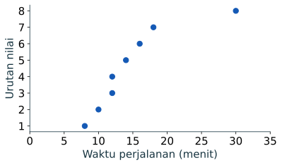

**Pencilan** adalah nilai yang jauh dari sebagian besar nilai lain menurut aturan tertentu. **Noise** adalah variasi atau gangguan yang tidak mewakili sinyal yang ingin dipelajari. Keduanya bukan sinonim kesalahan. Perjalanan 30 menit dapat sah walau jarang; sensor yang bergetar di sekitar 15 menit dapat menghasilkan noise walau semua nilainya berada di tengah sebaran.

## Tiga pertanyaan sebelum mengubah data

1. **Mungkin atau mustahil?** Durasi `-4` mustahil menurut definisi, tetapi 30 menit mungkin.
2. **Sumbernya apa?** Cek formulir, log, alat, satuan, rute, dan waktu pencatatan.
3. **Apa tujuan analisis?** Untuk pengalaman perjalanan panjang, nilai tinggi justru bagian penting; untuk melihat pola sensor per detik, gangguan pengukuran mungkin perlu diringkas.

Pada data perjalanan simulasi, waktu terurut adalah `8, 10, 12, 12, 14, 16, 18, 30`. Kita belum memiliki bukti apakah 30 adalah kesalahan. Ia tetap dipakai pada analisis utama.



## Pagar IQR: tanda untuk meninjau

Dengan kuartil pandas, `Q1 = 11,5`, `Q3 = 16,5`, dan `IQR = 5`. Pagar bawah `Q1 - 1,5 IQR = 4`; pagar atas `Q3 + 1,5 IQR = 24`. Hanya 30 yang melewati pagar.

```python
import pandas as pd
data = pd.read_csv("perjalanan_contoh.csv")
x = data["waktu_menit"]
q1, q3 = x.quantile([0.25, 0.75])
iqr = q3 - q1
bawah, atas = q1 - 1.5 * iqr, q3 + 1.5 * iqr
print("Pagar:", bawah, atas)
print("Kandidat:", x[(x < bawah) | (x > atas)].tolist())
```

Keluaran:

```text
Pagar: 4.0 24.0
Kandidat: [30]
```

Aturan IQR mengidentifikasi kandidat untuk diperiksa; ia tidak menghitung peluang suatu nilai salah. Pada sampel kecil, kuartil dan pagar mudah berubah jika satu baris berubah.

## Skor baku tidak selalu lebih baik

Skor baku `z = (x - mean) / simpangan baku` menyatakan jarak dalam satuan simpangan baku. Namun mean dan simpangan baku ikut berubah karena nilai ekstrem. Pada delapan nilai ini, skor 30 hanya sekitar 2,19, meski melewati pagar IQR. Ambang seperti `|z| > 3` bukan hukum umum; distribusi miring dan ukuran sampel kecil membuatnya mudah menyesatkan.

```python
z_30 = (30 - x.mean()) / x.std()
print(round(z_30, 2))
```

Keluaran: `2.19`.

## Empat perlakuan yang berbeda

| Keadaan setelah pemeriksaan | Perlakuan | Apa yang dilaporkan |
|---|---|---|
| Salah input terverifikasi | Koreksi dari sumber asli | Nilai lama, nilai baru, bukti |
| Nilai di luar domain, sumber tidak dapat dipulihkan | Tandai hilang atau keluarkan dari analisis variabel terkait | Jumlah baris terdampak dan alasannya |
| Nilai ekstrem sah | Pertahankan; gunakan median/IQR dan tampilkan grafik | Ringkasan dengan seluruh data |
| Status belum pasti | Pertahankan analisis utama; bandingkan skenario | Hasil keduanya dan batas kesimpulan |

**Winsorisasi** mengganti nilai di luar batas dengan nilai batas, sedangkan **pemangkasan** membuangnya. Keduanya mengubah pertanyaan dan distribusi. Jangan menerapkannya semata-mata agar grafik atau uji tampak “rapi”. Jika dipakai, tetapkan aturan sebelum melihat hasil utama dan laporkan proporsi yang berubah.

## Analisis kepekaan: apa yang berubah?

```python
utama = x.mean()
skenario = x[x != 30].mean()
print("Seluruh 8 baris:", round(utama, 2))
print("Tanpa kandidat, 7 baris:", round(skenario, 2))
print("Median seluruh data:", x.median())
```

Keluaran:

```text
Seluruh 8 baris: 15.0
Tanpa kandidat, 7 baris: 12.86
Median seluruh data: 13.0
```

Selisih mean 2,14 menit menunjukkan bahwa nilai 30 berpengaruh. Ia tidak membuktikan bahwa 30 salah. Median seluruh data mendekati mean skenario, sehingga baik untuk menyampaikan waktu tipikal sambil tetap mempertahankan 30 sebagai bagian sebaran.

## Noise memerlukan model pengukuran

Misalkan sensor mencatat `14, 15, 16, 15, 14` setiap detik saat keadaan yang ingin diamati relatif tetap. Fluktuasi 1 satuan mungkin noise alat. Rata-rata tiga pengamatan bertetangga dapat membantu melihat kecenderungan, tetapi akan menyamarkan puncak singkat yang mungkin penting. Untuk data perjalanan orang per orang, merata-ratakan antarorang sebagai “pengurangan noise” justru menghapus variasi nyata.

```python
sensor = pd.Series([14, 15, 16, 15, 14])
print(sensor.rolling(3, center=True).mean().round(2).tolist())
```

Keluaran: `[nan, 15.0, 15.33, 15.0, nan]`. Dua ujung tidak memiliki tiga pengamatan bertetangga. Perataan hanya layak jika frekuensi pengukuran, tujuan, dan konsekuensi hilangnya puncak sudah dipahami.

:::caution[Kesalahan umum]
Menghapus setiap baris yang ditandai oleh skor baku atau IQR dapat menghilangkan kejadian langka yang justru penting. Jelaskan keputusan per nilai atau kelompok nilai dengan bukti sumber dan tujuan analisis.
:::

## Mini test

Sebuah alat menghitung 500 kendaraan per jam saat jam sibuk; pada jam lain nilainya 40–80. Sebutkan dua penjelasan yang mungkin untuk 500 dan bukti apa yang perlu dicari. Apakah perataan lima jam selalu aman?

<details><summary>Periksa pembahasan</summary>

Nilai 500 dapat berasal dari lonjakan lalu lintas nyata atau kesalahan alat/penyatuan beberapa interval. Periksa rekaman mentah, durasi interval, log alat, dan pengamatan sekitar. Perataan dapat menyembunyikan puncak yang penting untuk kapasitas jalan, sehingga tidak otomatis tepat.

</details>
