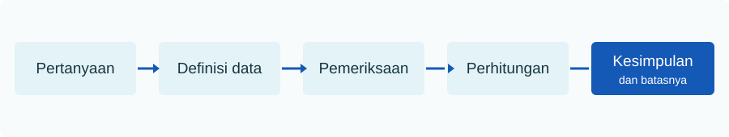

Sebelum mengumpulkan data, tulis keputusan yang ingin didukung. Contoh: **“Apakah waktu berjalan kaki menuju taman berbeda antarbagian kota?”** Pertanyaan itu memerlukan definisi taman, titik awal, rute berjalan kaki, waktu pengamatan, dan kelompok wilayah. Tanpa definisi tersebut, dua angka yang sama mungkin berasal dari pengukuran berbeda.

Untuk mencoba pemeriksaan Python pada halaman ini, unggah [CSV contoh](../../unduh-data/) lalu jalankan:

```python
import pandas as pd
data = pd.read_csv("perjalanan_contoh.csv")
```

## Sumber dan cara memperoleh data

**Data primer** dikumpulkan langsung untuk pertanyaan yang sedang diteliti, misalnya pengamatan, survei, wawancara terstruktur, atau pengukuran sensor. **Data sekunder** sudah dikumpulkan pihak lain, misalnya sensus, data administrasi, atau repositori terbuka. Keduanya dapat bermutu baik atau buruk; asal dan metode perlu dicatat.

Pengamatan mencatat apa yang terjadi tanpa mengatur perlakuan. Eksperimen mengalokasikan perlakuan dan membandingkan hasilnya dengan rancangan yang jelas. Hubungan pada data pengamatan tidak langsung menyatakan sebab akibat karena faktor lain dapat memengaruhi kedua variabel.

| Cara | Keunggulan | Keterbatasan yang perlu dicatat |
|---|---|---|
| Survei | Dapat menanyakan pengalaman atau pilihan | Tidak semua orang merespons; jawaban dapat keliru |
| Observasi lapangan | Mencatat kondisi pada waktu tertentu | Waktu dan lokasi pengamatan membatasi cakupan |
| Data administrasi | Dapat mencakup banyak unit dan periode | Definisi dibuat untuk kebutuhan administrasi |
| Sensor atau aplikasi | Pengukuran berulang dan rinci | Kalibrasi, cakupan perangkat, serta privasi |

## Rancangan yang dapat diperiksa

1. **Sasaran:** seluruh unit mana yang ingin dibahas? Sertakan wilayah dan periode.
2. **Unit:** satu perjalanan, orang, rumah tangga, ruas jalan, atau zona?
3. **Kerangka:** daftar unit mana yang bisa dipilih? Siapa yang tidak tercakup?
4. **Pemilihan:** apakah unit dipilih acak, berstrata, atau karena mudah dijangkau?
5. **Pengukuran:** bagaimana variabel diukur, dalam satuan apa, oleh siapa?
6. **Etika:** apakah data memuat identitas atau lokasi yang dapat mengenali orang?

## Sensus, sampel, dan pemilihan

**Sensus** berusaha mencatat seluruh unit pada populasi yang didefinisikan. **Sampel** mencatat sebagian unit. Pada sampel acak sederhana, setiap unit dalam kerangka memiliki peluang terpilih yang diketahui. Pada sampel berstrata, populasi dibagi ke kelompok bermakna, lalu pemilihan dilakukan dalam tiap kelompok. Pada sampel kemudahan, unit dipilih karena mudah dijangkau; temuan sering sulit digeneralisasi.

Kerangka sampel adalah daftar atau mekanisme yang memungkinkan unit dipilih. Jika kerangka hanya berisi pengguna aplikasi, warga tanpa aplikasi tidak mungkin terpilih. Menambah banyak respons dari kerangka yang tidak lengkap tidak memperbaiki masalah cakupan.

### Empat sumber bias yang mudah tertukar

| Sumber | Contoh | Pertanyaan pemeriksaan |
|---|---|---|
| Cakupan | Daftar hanya memuat pengguna aplikasi | Siapa yang sama sekali tidak mungkin terpilih? |
| Pemilihan | Pengamatan hanya pada lokasi yang mudah dicapai | Mengapa lokasi tersebut masuk data? |
| Nonrespons | Pekerja malam jarang menjawab survei siang | Siapa yang diundang tetapi tidak menjawab? |
| Pengukuran | Pertanyaan “perjalanan normal” dipahami berbeda | Apakah definisi dan alat sama untuk semua unit? |

**Kesalahan acak** dapat berkurang ketika sampel acak yang sah bertambah besar. Empat sumber bias di atas memerlukan perbaikan rancangan atau pengukuran. Sebelum mengumpulkan ribuan baris, coba formulir pada beberapa unit untuk menemukan istilah rancu dan rentang jawaban yang tidak masuk akal.

### Kamus data sebelum survei

| Kolom | Definisi operasional | Tipe/skala | Satuan atau kategori | Nilai kosong |
|---|---|---|---|---|
| `id_perjalanan` | Pengenal satu kejadian perjalanan | Nominal | Unik per kejadian | Tidak boleh kosong |
| `moda` | Moda utama menurut durasi terpanjang | Nominal | Bus, Motor, Jalan kaki, Sepeda, Lainnya | Kode `tidak tahu` terpisah |
| `waktu_menit` | Durasi sejak berangkat hingga tiba | Rasio | Menit, ≥0 | Catat alasan bila kosong |

Definisi moda utama di tabel ini hanyalah **contoh rancangan**. Riset lain dapat memilih jarak terpanjang atau moda pada segmen terakhir. Pilihan harus diputuskan sebelum data dikumpulkan agar semua pengamat memakai aturan sama.

## Mutu data sebelum analisis

Periksa **kelengkapan** (nilai hilang), **ketepatan** (nilai sesuai pengukuran), **konsistensi** (kategori dan satuan seragam), **keberulangan** (duplikat atau unit berulang), dan **ketepatan waktu**. Nilai kosong dapat berarti tidak ditanya, tidak dijawab, atau tidak berlaku. Ketiganya perlu kode dan perlakuan berbeda.

Kamus data sebaiknya memuat nama kolom, definisi, satuan, kategori yang sah, cara pengukuran, periode, cakupan, sumber, dan aturan untuk nilai hilang. Simpan berkas mentah terpisah dari hasil pembersihan agar keputusan dapat ditelusuri.



:::caution[Bias tidak hilang karena ukuran sampel besar]
Jika survei hanya dilakukan pada pengguna aplikasi tertentu, menambah jumlah responden dari aplikasi itu tidak otomatis mencakup warga yang tidak memakai aplikasi. Catat siapa yang terlewat sebelum menafsirkan angka.
:::

:::note[Tiga sumber kesalahan]
**Bias seleksi** muncul ketika unit yang masuk berbeda secara sistematis dari sasaran. **Bias pengukuran** muncul ketika alat atau pertanyaan memberi nilai yang keliru secara sistematis. **Galat acak** adalah perubahan yang tidak terarah dari pengamatan ke pengamatan. Ukuran sampel yang besar terutama mengurangi sebagian ketidakpastian acak, bukan otomatis memperbaiki bias.
:::

## Pemeriksaan awal di Python

```python
print("Baris duplikat:", data.duplicated().sum())
print("Jumlah baris:", len(data))
print("Waktu minimum:", data["waktu_menit"].min())
print("Waktu maksimum:", data["waktu_menit"].max())
```

Keluaran untuk data contoh:

```text
Baris duplikat: 0
Jumlah baris: 8
Waktu minimum: 8
Waktu maksimum: 30
```

Hasil ini hanya menjawab pemeriksaan teknis. Waktu 30 menit bisa sah, salah ketik, atau berbeda konteks. Data contoh tidak menyediakan informasi untuk memutuskan. Jangan menghapusnya tanpa alasan yang dapat dicatat.

## Kasus: akses taman

Pada dataset latihan, setiap baris diberi kode zona A sampai L. Angka `jalan_kaki_menit` disusun sebagai skenario, bukan diukur di lapangan. Jika ingin membuat studi nyata, tentukan apakah waktu berasal dari pengukuran berjalan kaki, jaringan jalan digital, atau jawaban responden. Ketiganya dapat berbeda. Untuk analisis spasial, catat sistem koordinat dan aturan memilih titik asal serta taman tujuan.

## Coba sendiri

Tulis empat informasi yang perlu ditambahkan sebelum data akses taman dapat dipakai membandingkan wilayah nyata. Lalu jalankan `data.isna().sum()` pada data perjalanan. Apa yang dapat dan tidak dapat disimpulkan dari nol nilai kosong?

Tambahan: sebuah survei daring menerima 2.000 jawaban sukarela. Apakah jumlah itu saja cukup untuk menyatakan hasilnya mewakili semua penduduk? Sebutkan informasi pemilihan responden yang masih diperlukan.

<details><summary>Periksa pembahasan</summary>

Contoh informasi: lokasi dan periode, definisi titik asal, metode mengukur waktu, cara memilih zona, serta kondisi rute. Nol nilai kosong berarti setiap sel terisi. Hal itu tidak membuktikan ketepatan pengukuran, keterwakilan, atau ketiadaan bias.

Jumlah 2.000 tidak menjawab siapa yang berkesempatan ikut, siapa yang tidak merespons, dan bagaimana peserta berbeda dari populasi sasaran. Perlu definisi populasi, kerangka atau jalur undangan, peluang pemilihan bila ada, serta tingkat respons.

</details>
