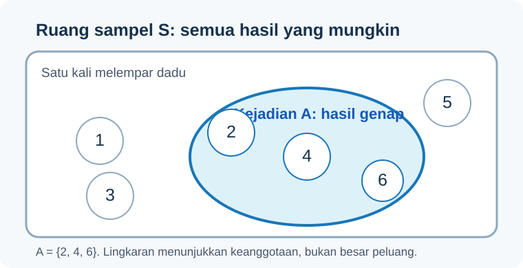
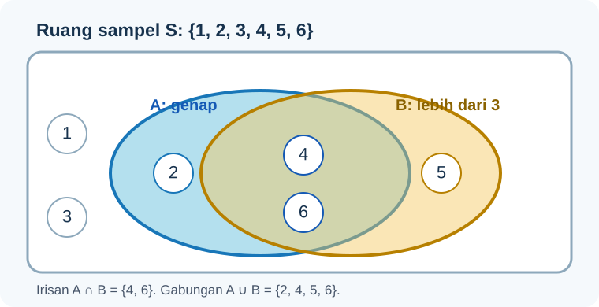
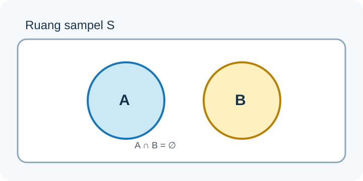

import RunnablePlot from '../../../components/RunnablePlot.astro';

Bayangkan sebuah dadu dilempar satu kali. Sebelum dadu berhenti, kita belum tahu angka yang muncul. Kita tahu bahwa hasilnya hanya mungkin 1, 2, 3, 4, 5, atau 6. Probabilitas membantu kita membicarakan ketidakpastian itu dengan cara yang teratur.

Kita mulai dari dadu karena semua hasilnya mudah ditulis. Setelah itu, gagasan yang sama bisa dipakai untuk pertanyaan lain, misalnya peluang sebuah lokasi memiliki halte dalam jarak tertentu atau peluang sebuah survei menemukan kondisi tertentu.

## Hasil yang mungkin dan ruang sampel

Satu hasil adalah satu kemungkinan yang dapat terjadi. Pada satu lemparan dadu, hasilnya bisa 1, 2, 3, 4, 5, atau 6.

Kumpulan semua hasil yang mungkin disebut **ruang sampel**. Kita beri nama `S`:

```text
S = {1, 2, 3, 4, 5, 6}
```

Ruang sampel harus mengikuti pertanyaan yang sedang kita ajukan. Jika dadu dilempar sekali, hasil seperti `1 lalu 4` tidak termasuk. Jika dadu dilempar dua kali, hasilnya berupa pasangan seperti `(1, 4)` dan ruang sampelnya lebih besar.

## Kejadian adalah bagian dari ruang sampel

Kejadian adalah kumpulan hasil yang memenuhi satu syarat. Misalnya, kita ingin tahu apakah hasil dadu genap. Kejadian `A` berisi angka 2, 4, dan 6:

```text
A = {2, 4, 6}
```

Diagram berikut memakai kotak untuk seluruh hasil yang mungkin dan lingkaran untuk hasil yang memenuhi syarat A.



Bayangkan kotak itu sebagai batas semua hasil yang sedang kita pertimbangkan. Lingkaran tidak selalu menunjukkan peluang yang lebih besar atau lebih kecil. Lingkaran hanya menunjukkan hasil mana yang masuk ke dalam kejadian. Pada dadu adil, peluang dapat dihitung dari banyaknya hasil karena keenam sisi dianggap sama mungkin.

:::note[Contoh di luar dadu]
Misalkan kita memeriksa semua halte di sebuah kawasan. Jika ruang sampelnya adalah seluruh halte yang tercatat, kejadian A dapat berarti “halte memiliki tempat berteduh”. Ruang sampel menjawab “halte mana saja yang kita hitung?”, sedangkan kejadian menjawab “halte mana yang memenuhi syarat?”.
:::

## Mengubah kejadian menjadi peluang

Untuk hasil yang sama mungkin, peluang diperoleh dengan membagi banyak hasil yang memenuhi kejadian dengan banyak semua hasil:

```text
P(A) = banyak hasil di A / banyak hasil di S
```

Pada dadu adil, ada tiga angka genap dari enam hasil. Jadi:

```text
P(A) = 3/6 = 1/2 = 0,5 = 50%
```

Angka 0,5 berarti, dalam model dadu adil, kejadian genap memiliki peluang satu dari dua. Itu bukan janji bahwa setiap dua lemparan pasti menghasilkan tepat satu angka genap. Peluang menjelaskan pola jangka panjang model, bukan memastikan hasil satu percobaan.

Peluang selalu berada di antara 0 dan 1. Nilai 0 berarti kejadian tidak mungkin dalam ruang sampel yang ditentukan. Nilai 1 berarti kejadian pasti terjadi dalam ruang sampel itu. Untuk dadu satu lemparan, peluang mendapatkan angka 8 adalah 0, sedangkan peluang mendapatkan angka dari 1 sampai 6 adalah 1.

### Tiga cara menyatakan peluang

| Cara | Dari mana nilainya berasal? | Contoh sederhana |
|---|---|---|
| Teoretis | Aturan atau model tentang hasil yang mungkin | Dadu adil: peluang genap adalah 3 dari 6 |
| Empiris | Banyaknya kejadian yang benar-benar tercatat dibagi banyak pengamatan | Dari 20 pemeriksaan, 8 halte memiliki tempat berteduh: 8/20 |
| Penilaian ahli | Perkiraan yang disusun dari informasi dan pengalaman, dengan alasan yang dijelaskan | Perkiraan peluang banjir berdasarkan peta, tinggi genangan, dan catatan kejadian |

Angka 8 dari 20 pada contoh empiris hanya meringkas 20 pemeriksaan itu. Untuk memperkirakan keadaan semua halte, kita perlu tahu cara memilih halte dan apakah pemeriksaan tersebut mewakili kawasan yang ingin dibahas.

## Dua kejadian: “dan” serta “atau”

Sekarang kita lihat dua kejadian pada dadu yang sama:

- `A`: hasilnya genap, yaitu `{2, 4, 6}`.
- `B`: hasilnya lebih besar dari 3, yaitu `{4, 5, 6}`.

**Irisan** adalah hasil yang memenuhi A dan B sekaligus. Simbolnya `A ∩ B`. Di sini hasilnya `{4, 6}`.

**Gabungan** adalah hasil yang memenuhi A, B, atau keduanya. Simbolnya `A ∪ B`. Di sini hasilnya `{2, 4, 5, 6}`.



Diagram ini membantu melihat keanggotaan. Untuk mendapatkan hitungan yang tepat, tulis hasilnya satu per satu: A memuat 3 hasil, B memuat 3 hasil, dan irisan memuat 2 hasil. Maka gabungan memuat `3 + 3 - 2 = 4` hasil. Irisan dikurangi karena angka 4 dan 6 sempat terhitung dua kali.

Rumus peluang gabungan dua kejadian adalah:

```text
P(A ∪ B) = P(A) + P(B) - P(A ∩ B)
```

Pada contoh dadu:

```text
P(A ∪ B) = 3/6 + 3/6 - 2/6 = 4/6
```

## Komplemen: kejadian “bukan A”

**Komplemen** A berisi semua hasil di ruang sampel yang tidak termasuk A. Simbolnya `Aᶜ`. Jika A adalah “angka genap”, maka `Aᶜ = {1, 3, 5}`.

Karena setiap hasil masuk ke A atau ke Aᶜ, jumlah peluang keduanya adalah 1:

```text
P(Aᶜ) = 1 - P(A)
```

Maka peluang mendapatkan angka ganjil adalah `1 - 1/2 = 1/2`. Cara komplemen sering lebih singkat saat kejadian yang ditanyakan sulit dihitung langsung. Contohnya, peluang “setidaknya satu angka 6 dalam dua lemparan” lebih mudah dihitung dengan mencari peluang “tidak ada angka 6”, lalu mengurangkannya dari 1.

## Saling lepas

Dua kejadian disebut **saling lepas** jika tidak memiliki hasil yang sama. Contohnya, pada satu lemparan dadu, kejadian `C = {1}` dan `D = {6}` tidak dapat terjadi bersamaan.



Karena tidak ada irisan, `P(C ∩ D) = 0`. Jadi peluang C atau D adalah `P(C) + P(D) = 1/6 + 1/6 = 2/6`.

Saling lepas menjelaskan apakah dua kejadian bisa terjadi bersamaan. Istilah ini berbeda dari **independen**, yang menjelaskan apakah informasi tentang satu kejadian mengubah peluang kejadian lain. Kita akan membahasnya pada [bab peluang bersyarat dan independensi](../peluang-bersyarat-independensi/).

## Coba hitung dengan Python

Kita dapat menyimpan hasil dadu sebagai daftar, lalu menyaring hasil yang memenuhi syarat. Baris kode ini menggunakan Python dasar, tanpa paket tambahan.

```python
hasil_dadu = [1, 2, 3, 4, 5, 6]
hasil_genap = [angka for angka in hasil_dadu if angka % 2 == 0]

peluang_genap = len(hasil_genap) / len(hasil_dadu)
print("Hasil genap:", hasil_genap)
print("Peluang genap:", peluang_genap)
```

Keluaran:

```text
Hasil genap: [2, 4, 6]
Peluang genap: 0.5
```

`hasil_dadu` menuliskan ruang sampel. Baris berikutnya membuat daftar baru yang hanya berisi angka genap. Tanda `%` mencari sisa pembagian; angka genap memiliki sisa 0 ketika dibagi 2. Fungsi `len()` menghitung banyak anggota daftar. Pembagian terakhir mengikuti rumus peluang untuk hasil yang sama mungkin.

## Lab: ubah syarat kejadian

Jalankan kode ini. Untuk mencoba syarat lain, ganti `angka % 2 == 0` menjadi `angka > 3` atau `angka == 6`. Sebelum menjalankan, tulis prediksi jumlah hasil yang akan masuk ke kejadian.

<RunnablePlot title="Membentuk kejadian dari ruang sampel" code={`hasil_dadu = [1, 2, 3, 4, 5, 6]
kejadian = [angka for angka in hasil_dadu if angka % 2 == 0]

jumlah_semua = len(hasil_dadu)
jumlah_memenuhi = len(kejadian)
peluang = jumlah_memenuhi / jumlah_semua

print("Ruang sampel:", hasil_dadu)
print("Kejadian:", kejadian)
print("Banyak hasil yang memenuhi:", jumlah_memenuhi)
print("Banyak seluruh hasil:", jumlah_semua)
print("Peluang:", jumlah_memenuhi, "/", jumlah_semua, "=", peluang)
`} />

### Periksa hasil

Pada syarat angka genap, kejadian berisi `[2, 4, 6]`, sehingga hasilnya `3/6 = 0.5`. Jika syarat diubah menjadi `angka > 3`, kejadian berisi `[4, 5, 6]` dan peluangnya tetap 0.5. Jika syaratnya `angka == 6`, hanya satu hasil yang memenuhi dan peluangnya `1/6`.

:::caution[Model dadu]
Hitungan `banyak hasil yang memenuhi / banyak seluruh hasil` hanya tepat jika semua hasil dalam ruang sampel sama mungkin. Untuk dadu yang berat sebelah, keenam hasil masih mungkin muncul, tetapi peluangnya belum tentu sama. Kita perlu data ulangan atau model lain untuk menilai peluangnya.
:::

## Uji pemahaman

1. Pada satu lemparan dadu, tuliskan ruang sampel dan kejadian “hasil kurang dari 3”. Berapa peluangnya jika dadu adil?
2. Untuk A = “angka genap” dan B = “angka lebih dari 3”, tuliskan `A ∩ B` dan `A ∪ B`.
3. Jika peluang suatu kejadian adalah 0,3, berapa peluang komplemennya?
4. Dari 10 persimpangan yang dipilih untuk diamati, 4 memiliki zebra cross. Sebutkan peluang empiris pada 10 persimpangan itu. Mengapa angka tersebut belum otomatis menggambarkan semua persimpangan kota?

<details>
<summary>Pembahasan</summary>
<p>1. Ruang sampelnya {1, 2, 3, 4, 5, 6}; hasil kurang dari 3 adalah {1, 2}, jadi peluangnya 2/6 = 1/3. 2. Irisannya {4, 6}; gabungannya {2, 4, 5, 6}. 3. 1 - 0,3 = 0,7. 4. Proporsinya 4/10 = 0,4 pada persimpangan yang diamati. Cara memilih 10 persimpangan dan cakupan wilayah menentukan apakah proporsi itu dapat mewakili kota.</p>
</details>

## Kesimpulan

Ruang sampel adalah daftar semua hasil yang mungkin untuk pertanyaan yang kita tetapkan. Kejadian adalah bagian dari daftar itu. Jika hasilnya sama mungkin, peluang adalah banyak hasil yang memenuhi syarat dibagi banyak seluruh hasil. Irisan berarti dua syarat terjadi bersama, gabungan berarti salah satu atau keduanya terjadi, dan komplemen berarti kejadian tidak terjadi.

Lanjut ke [peluang bersyarat dan independensi](../peluang-bersyarat-independensi/) untuk melihat bagaimana pertanyaan baru dapat mengubah kelompok yang menjadi penyebut.
