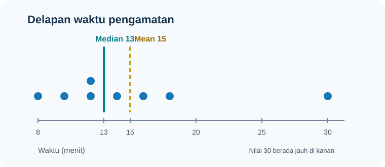

import RunnablePlot from '../../../components/RunnablePlot.astro';

Sesudah menghitung pusat dan penyebaran, grafik membantu melihat bentuk data yang tidak tertangkap oleh satu angka ringkasan. Gunakan grafik untuk menjawab pertanyaan tertentu; jangan memilihnya hanya karena tampil menarik.

## Mulai dari tabel yang dapat diperiksa

Untuk data kategori, mulai dari tabel frekuensi. Contoh delapan pilihan moda berikut dibuat untuk latihan.

| Moda | Frekuensi | Proporsi |
|---|---:|---:|
| Bus | 2 | 0,25 |
| Jalan kaki | 2 | 0,25 |
| Motor | 2 | 0,25 |
| Sepeda | 2 | 0,25 |
| **Jumlah** | **8** | **1,00** |

Frekuensi adalah banyak kemunculan; proporsi adalah frekuensi dibagi seluruh observasi. Tabel kumulatif cocok untuk kategori berurutan atau nilai numerik yang diurutkan, bukan label nominal seperti moda.

Untuk nilai numerik, interval kelas dapat merangkum banyak nilai. Tulis batas kelas dan satuannya dengan jelas. Pilihan lebar kelas mengubah kesan pola; selalu periksa beberapa lebar yang masuk akal dan, bila datanya sedikit, tampilkan nilai individual melalui dot plot.

## Pilih grafik dari pertanyaan

| Pertanyaan | Bentuk yang sesuai | Yang ditampilkan | Perhatian |
|---|---|---|---|
| Berapa banyak pada tiap kategori? | Batang | Frekuensi atau proporsi kategori | Batang mulai dari nol; urutkan secara bermakna. |
| Bagaimana nilai numerik tersebar? | Histogram | Banyak nilai dalam interval | Bentuk berubah menurut lebar dan awal interval. |
| Di mana pusat dan rentang tengah? | Boxplot | Median, kuartil, whisker, calon pencilan | Titik di luar whisker bukan otomatis kesalahan. |
| Bagaimana nilai berubah menurut waktu? | Grafik garis | Pengamatan berurutan waktu | Hubungkan titik hanya bila urutan waktu bermakna. |
| Apakah dua ukuran bergerak bersama? | Diagram pencar | Sepasang nilai untuk tiap unit | Hubungan tidak membuktikan sebab-akibat. |
| Bagaimana kategori menyusun keseluruhan? | Batang bertumpuk atau 100% | Bagian dalam kelompok | Sulit membandingkan segmen yang tidak berbagi garis dasar. |
| Berapa bagian dari satu total? | Diagram lingkaran, terbatas | Proporsi kategori yang saling lepas | Hindari banyak irisan atau membandingkan sudut yang mirip. |
| Bagaimana kumulasi nilai? | Ogive | Frekuensi/proposi kumulatif | Jelaskan batas kelas dan penyebut. |
| Bagaimana frekuensi antar kelas berubah? | Poligon frekuensi | Titik tengah kelas dan frekuensi | Cocok untuk membandingkan beberapa distribusi. |

Batang dan histogram berbeda: batang membandingkan kategori terpisah; batang histogram menyentuh karena interval numerik bersebelahan. Jangan pakai grafik garis untuk label kategori yang tidak memiliki urutan.

## Dasar Matplotlib: Figure, Axes, dan mark

Matplotlib memetakan nilai ke tanda visual. **Figure** adalah keseluruhan kanvas; **Axes** adalah bidang grafik di dalamnya. Pola `fig, ax = plt.subplots()` memudahkan mengatur grafik. Rujuk [Pyplot tutorial](https://matplotlib.org/stable/tutorials/pyplot.html), [Figures](https://matplotlib.org/stable/users/explain/figure/figure_intro.html), dan [Axes](https://matplotlib.org/stable/users/explain/axes/axes_intro.html).

```python
import matplotlib.pyplot as plt

moda = ["Bus", "Jalan kaki", "Motor", "Sepeda"]
jumlah = [2, 2, 2, 2]
fig, ax = plt.subplots(figsize=(7, 4))
ax.bar(moda, jumlah, color="#1876b8")
ax.set_title("Jumlah perjalanan menurut moda")
ax.set_xlabel("Moda")
ax.set_ylabel("Jumlah perjalanan")
ax.set_ylim(0, 3)
fig.tight_layout()
plt.show()
```

| Baris | Fungsi |
|---|---|
| `import matplotlib.pyplot as plt` | Memuat antarmuka grafik dan memberi nama singkat `plt`. |
| `moda` dan `jumlah` | Menyimpan label dan tinggi batang pada posisi yang sama. |
| `fig, ax = plt.subplots(...)` | Membuat kanvas `fig` dan bidang gambar `ax`. |
| `ax.bar(...)` | Menggambar satu batang untuk tiap pasangan kategori–jumlah. |
| `set_title`, `set_xlabel`, `set_ylabel` | Memberi judul dan menjelaskan kedua sumbu. |
| `set_ylim(0, 3)` | Menetapkan rentang sumbu; batang dimulai dari nol agar panjangnya jujur. |
| `fig.tight_layout()` | Mengurangi tumpang tindih judul dan label. |
| `plt.show()` | Menampilkan grafik di notebook. Di lab halaman ini, simpan sebagai SVG. |

## Ukuran pemusatan dan penyebaran dalam gambar

Mean dan median dapat berdekatan atau berjauhan. Histogram memperlihatkan bentuk keseluruhan; garis vertikal membantu menandai pusat. Boxplot memberi median, kuartil, dan rentang nilai, tetapi tidak menunjukkan detail tiap pengamatan.



Data waktu berikut dibuat untuk latihan:

```python
waktu = [8, 10, 12, 12, 14, 16, 18, 30]
```

Pada data ini mean = 15 dan median = 13. Nilai 30 menarik mean ke kanan, sedangkan median tetap mengikuti posisi tengah. IQR = 5 menunjukkan sebaran 50% nilai tengah. Pelajari makna dan rumusnya pada [ukuran pemusatan](../deskriptif-pusat/) dan [ukuran penyebaran](../deskriptif-sebaran/).

## Lab: bandingkan empat tampilan

Ubah nilai terakhir dari 30 menjadi 20, jalankan ulang, lalu amati mean, median, histogram, dan boxplot. Jangan hapus nilai 30 hanya karena tampak jauh.

<RunnablePlot title="Lab visualisasi statistik deskriptif" code={`import matplotlib
matplotlib.use("AGG")
import matplotlib.pyplot as plt
from statistics import mean, median

waktu = [8, 10, 12, 12, 14, 16, 18, 30]
rata_rata = mean(waktu)
nilai_tengah = median(waktu)

print("Jumlah pengamatan:", len(waktu))
print("Mean:", round(rata_rata, 2), "menit")
print("Median:", round(nilai_tengah, 2), "menit")

fig, axes = plt.subplots(2, 2, figsize=(9, 6))

axes[0, 0].hist(waktu, bins=6, color="#1876b8", edgecolor="white")
axes[0, 0].axvline(rata_rata, color="#d49b18", linestyle="--", label="Mean")
axes[0, 0].axvline(nilai_tengah, color="#087e8b", linestyle="-", label="Median")
axes[0, 0].set_title("Histogram")
axes[0, 0].set_xlabel("Waktu (menit)")
axes[0, 0].set_ylabel("Frekuensi")
axes[0, 0].legend()

axes[0, 1].boxplot(waktu, vert=False)
axes[0, 1].set_title("Boxplot")
axes[0, 1].set_xlabel("Waktu (menit)")

axes[1, 0].bar(["Mean", "Median"], [rata_rata, nilai_tengah],
               color=["#d49b18", "#087e8b"])
axes[1, 0].set_title("Dua ukuran pusat")
axes[1, 0].set_ylabel("Menit")
axes[1, 0].set_ylim(0, 18)

axes[1, 1].plot(range(1, len(waktu) + 1), sorted(waktu),
                marker="o", color="#1876b8")
axes[1, 1].set_title("Nilai setelah diurutkan")
axes[1, 1].set_xlabel("Posisi urutan")
axes[1, 1].set_ylabel("Waktu (menit)")

fig.tight_layout()
fig.savefig("/tmp/statistik-plot.svg")
`} />

### Cara membaca baris utama

- `mean(waktu)` dan `median(waktu)` menghitung dua ukuran pusat dari list.
- `plt.subplots(2, 2, ...)` membuat satu Figure dengan empat Axes; `axes[0, 0]` berarti baris pertama, kolom pertama.
- `hist()` mengelompokkan data numerik menjadi interval; `bins=6` meminta enam interval.
- `axvline()` menambahkan garis vertikal untuk menandai mean dan median.
- `boxplot(..., vert=False)` menggambar boxplot mendatar agar skala waktu mudah dibaca.
- `bar()` membandingkan dua angka, sementara grafik kanan hanya menampilkan nilai yang sudah diurutkan; garis itu bukan tren waktu.
- `fig.savefig(...)` menyimpan gambar agar lab dapat menampilkannya setelah kode berjalan.

Hasil acuan: 8 pengamatan, mean 15 menit, median 13 menit. Setelah 30 diubah menjadi 20, mean menjadi 13,75; median tetap 13. Boxplot menampilkan calon pencilan menurut aturan 1,5 × IQR, bukan keputusan untuk membuang data.

## Lab: kategori, komposisi, hubungan, dan waktu

Empat grafik berikut memakai pertanyaan yang berbeda. Ganti satu nilai atau satu label, jalankan, lalu amati bagian gambar yang ikut berubah. Data ini simulasi kecil untuk memahami bentuk grafik.

<RunnablePlot title="Lab pilihan jenis grafik" code={`import matplotlib
matplotlib.use("AGG")
import matplotlib.pyplot as plt

moda = ["Bus", "Jalan kaki", "Motor", "Sepeda"]
jumlah = [2, 2, 2, 2]
jarak_meter = [250, 400, 550, 700, 850, 1000]
waktu_menit = [6, 8, 10, 12, 14, 17]
jam = [7, 8, 9, 10, 11, 12]
menit_perjalanan = [18, 16, 20, 14, 12, 15]

fig, axes = plt.subplots(2, 2, figsize=(9, 6))

axes[0, 0].bar(moda, jumlah, color="#1876b8")
axes[0, 0].set_title("Perbandingan kategori")
axes[0, 0].set_ylabel("Jumlah")
axes[0, 0].tick_params(axis="x", rotation=20)

axes[0, 1].pie(jumlah, labels=moda, autopct="%1.0f%%",
               startangle=90)
axes[0, 1].set_title("Bagian dari seluruh perjalanan")
axes[0, 1].set_aspect("equal")

axes[1, 0].scatter(jarak_meter, waktu_menit, color="#087e8b")
axes[1, 0].set_title("Hubungan jarak dan waktu")
axes[1, 0].set_xlabel("Jarak (meter)")
axes[1, 0].set_ylabel("Waktu (menit)")

axes[1, 1].plot(jam, menit_perjalanan, marker="o", color="#1876b8")
axes[1, 1].set_title("Perubahan waktu menurut jam")
axes[1, 1].set_xlabel("Jam pengamatan")
axes[1, 1].set_ylabel("Waktu perjalanan (menit)")
axes[1, 1].set_xticks(jam)

fig.tight_layout()
fig.savefig("/tmp/statistik-plot.svg")
`} />

| Bagian kode | Mengapa dipakai |
|---|---|
| `bar(moda, jumlah)` | Membandingkan jumlah pada kategori yang terpisah. |
| `pie(..., labels=..., autopct=...)` | Menunjukkan komposisi dari satu total; `autopct` menulis persentase pada irisan. |
| `set_aspect("equal")` | Menjaga lingkaran tidak tampak lonjong. |
| `scatter(jarak_meter, waktu_menit)` | Setiap titik memasangkan jarak dan waktu dari unit yang sama. |
| `plot(jam, menit_perjalanan, marker="o")` | Menghubungkan urutan jam ketika pertanyaan memang menyangkut perubahan terhadap waktu. |
| `set_xticks(jam)` | Menampilkan tanda sumbu pada jam yang diamati. |

Jangan menyimpulkan bahwa jarak menyebabkan waktu bertambah hanya dari diagram pencar. Rute, kondisi lalu lintas, dan cara pengukuran dapat berperan. Pie chart pada contoh dibatasi menjadi empat bagian; bila perbedaan kategori sulit dibandingkan, pilih batang.

## Membuat grafik mudah dibaca

1. Tulis pertanyaan dan unit observasi sebelum memilih bentuk grafik.
2. Beri judul yang menyebut variabel/konteks, bukan “Grafik 1”.
3. Beri label sumbu dan satuan; tulis sumber serta jumlah observasi bila relevan.
4. Untuk batang jumlah, mulai sumbu dari nol. Potongan sumbu dapat melebih-lebihkan perbedaan.
5. Pada histogram, nyatakan lebar interval atau jumlah bins. Coba beberapa pengaturan yang wajar.
6. Gunakan warna untuk membedakan seri yang punya makna. Pastikan tetap terbaca tanpa bergantung pada warna.
7. Jangan tampilkan garis penghubung pada kategori tanpa urutan.
8. Laporkan pencilan sebagai nilai yang perlu ditelusuri. Grafik tidak memberi alasan mengapa nilai terjadi.

Diagram lingkaran hanya cocok untuk beberapa kategori yang saling lepas dan membentuk satu total; batang biasanya lebih mudah dibandingkan. Lihat [dokumentasi pie chart Matplotlib](https://matplotlib.org/stable/api/_as_gen/matplotlib.pyplot.pie.html).

## Uji pemahaman

1. Untuk membandingkan banyaknya pilihan moda, pilih histogram atau grafik batang? Jelaskan jenis datanya.
2. Untuk melihat sebaran waktu tempuh numerik, pilih pie chart atau histogram?
3. Mengapa satu titik jauh dari whisker boxplot tidak cukup untuk menghapus observasi?
4. Dalam lab, apa yang terjadi pada mean dan median setelah 30 diganti 20? Mengapa?
5. Sebutkan label dan satuan yang diperlukan untuk grafik jarak dan waktu.

<details>
<summary>Pembahasan</summary>
<p>1. Grafik batang, karena moda adalah kategori. 2. Histogram, karena waktu adalah numerik. 3. Titik itu hanya calon pencilan menurut aturan grafis; periksa sumber, satuan, dan konteks. 4. Mean turun dari 15 menjadi 13,75; median tetap 13 karena posisi tengah tidak berubah. 5. Contohnya `Jarak (meter)` dan `Waktu (menit)`.</p>
</details>

## Kesimpulan

Ukuran pemusatan menunjukkan nilai representatif; ukuran penyebaran menunjukkan keragamannya; grafik memperlihatkan bentuk dan pengamatan yang mungkin tersembunyi di balik angka. Pilih tampilan dari pertanyaan, skala data, dan unitnya. Selalu baca hasil bersama sumber serta cara data dikumpulkan.

Uji seluruh alur melalui [praktik statistik deskriptif](../cek-deskriptif/).
