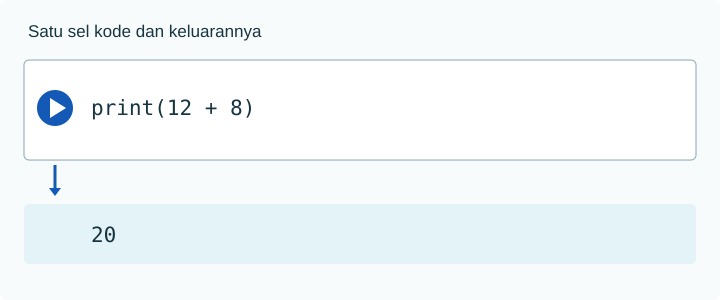

Google Colab menjalankan Python di peramban. Sebuah **notebook** berisi sel teks dan sel kode. Bayangkan notebook seperti buku catatan kerja: sel teks adalah tempat menulis pertanyaan dan penjelasan, sedangkan sel kode berisi perintah yang dapat dijalankan.

Sel teks cocok untuk pertanyaan, alasan memilih metode, dan interpretasi. Sel kode memuat perintah yang benar-benar dijalankan. Keduanya perlu agar pembaca lain dapat mengikuti analisis.



## Percobaan pertama

1. Buka [Google Colab](https://colab.research.google.com/).
2. Pilih **New notebook**. Klik sel kode pertama.
3. Ketik `print("Halo, statistik!")`, lalu tekan `Shift + Enter` atau <span class="colab-run-icon" aria-hidden="true">▶</span> tombol jalankan.
4. Tunggu sampai keluaran tampil. Simpan notebook dengan nama yang Anda kenali.

```python
print("Halo, statistik!")
```

Keluaran:

```text
Halo, statistik!
```

`print` meminta Python menampilkan sesuatu. Tanda kutip menandai teks. Tanda kurung membatasi bahan yang akan ditampilkan. Baca perintah dari nama fungsi, tanda kurung, lalu isi di dalamnya.

## Sel adalah langkah kerja

Satu sel dapat berisi satu perintah atau beberapa perintah. Saat ditekan ▶, Colab mengirim isi sel ke Python, Python menjalankannya, lalu hasilnya muncul tepat di bawah sel. Sel teks tidak dijalankan sebagai kode.

```python
print("Baris pertama")
print("Baris kedua")
```

Keluaran:

```text
Baris pertama
Baris kedua
```

Setiap `print()` membuat satu baris keluaran. Jika baris kedua salah, baris pertama mungkin sempat tampil, tetapi proses sel berhenti pada galat. Perbaiki kode lalu jalankan sel itu lagi.

## Urutan sel berpengaruh

Coba dua sel berikut dari atas ke bawah:

```python
waktu = 18
```

```python
print(waktu + 5)
```

Keluaran sel kedua:

```text
23
```

Jika sel kedua dijalankan sebelum sel pertama, Python belum mengenal `waktu` dan memberi `NameError`. Jalankan sel yang mendefinisikan variabel itu, lalu ulangi sel kedua.

Bayangkan kernel sebagai meja kerja yang menyimpan barang-barang bernama. Setelah `waktu = 18` dijalankan, nilai 18 tersedia pada nama `waktu`. Jika kernel dimulai ulang, meja kerja dikosongkan dan sel perlu dijalankan lagi dari atas.

:::tip[Jika hasil tampak tidak berubah]
Setelah mengubah sebuah sel, jalankan lagi sel tersebut dan semua sel setelahnya yang memakai hasilnya. Menu **Runtime → Run all** berguna untuk memeriksa notebook dari awal.
:::

## Siklus kerja yang aman

1. Beri judul dan tulis pertanyaan analisis pada sel teks.
2. Jalankan satu sel kode, baca keluaran, dan periksa apakah masuk akal.
3. Ubah satu bagian kecil, jalankan ulang, lalu bandingkan hasil.
4. Setelah selesai, jalankan seluruh notebook dari awal untuk menemukan ketergantungan pada sel lama.
5. Simpan notebook dan data masukan dengan nama yang dapat dikenali.

Tanda `[*]` di samping sel berarti proses masih berjalan. Jika proses berhenti atau sesi terputus, hubungkan kembali, lalu jalankan sel dari atas. Variabel dan berkas yang hanya berada di sesi sementara mungkin sudah hilang.

:::note[Angka di kiri sel]
Nomor seperti `[3]` menunjukkan urutan sel pernah dijalankan, bukan urutan letaknya di halaman. Jika sel `[7]` dijalankan sebelum sel `[4]`, keadaan kerja dapat berbeda dari urutan yang dibaca. Gunakan **Runtime → Run all** sebelum menyimpan hasil akhir.
:::

:::caution[Sesi Colab bersifat sementara]
Berkas CSV yang Anda unggah ke sesi Colab dapat hilang setelah sesi terputus. Simpan CSV dan notebook pada penyimpanan Anda. Jangan unggah data pribadi responden ke notebook publik.
:::

## Coba sendiri

Buat sel baru yang menampilkan `Saya sedang belajar Python`, lalu buat sel lain yang menghitung `12 + 8`. Prediksi dua keluarannya sebelum menjalankan.

<details><summary>Periksa jawaban</summary>

```python
print("Saya sedang belajar Python")
print(12 + 8)
```

Keluaran baris pertama berupa teks, sedangkan baris kedua berupa angka `20`. Tanda kutip membedakan teks dari perhitungan.

</details>

Lanjutkan ke [dasar Python](../dasar/).
