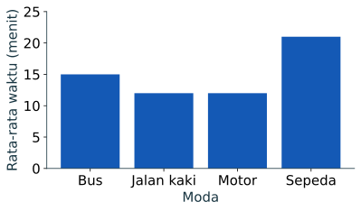
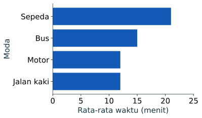

Grafik membantu pembaca melihat perbedaan dan pola sebelum membaca ukuran statistik. `matplotlib` membuat gambar dari data yang Anda berikan; ia tidak menentukan arti variabel atau menyimpulkan sebab akibat.

## Grafik batang dari rata-rata per moda

Contoh ini memakai rata-rata dari delapan baris perjalanan simulasi. Jalankan di Colab atau lingkungan Python yang sudah memiliki Matplotlib.

```python
import matplotlib.pyplot as plt

moda = ["Bus", "Motor", "Jalan kaki", "Sepeda"]
rata_rata_menit = [15, 12, 12, 21]

fig, ax = plt.subplots(figsize=(6, 3.5))
ax.bar(moda, rata_rata_menit, color="#1459b5")
ax.set_title("Rata-rata waktu perjalanan")
ax.set_xlabel("Moda")
ax.set_ylabel("Menit")
ax.set_ylim(0, 25)
fig.tight_layout()
plt.show()
```

Keluaran berupa grafik batang dengan empat batang. Tinggi batang menunjukkan rata-rata yang diberikan pada `rata_rata_menit`: Bus 15, Motor 12, Jalan kaki 12, dan Sepeda 21 menit. Satu batang tidak memperlihatkan jumlah baris, jadi tuliskan ukuran kelompok ketika grafik digunakan dalam laporan.



## Grafik dari DataFrame

Daripada mengetik rata-rata secara manual, hitung dari tabel lalu plot hasilnya. Cara ini menjaga hubungan antara data dan grafik tetap terlihat.

```python
from io import StringIO
import pandas as pd
import matplotlib.pyplot as plt

csv_text = """moda,waktu_menit
Bus,12
Bus,18
Motor,10
Motor,14
Jalan kaki,8
Jalan kaki,16
Sepeda,12
Sepeda,30
"""
data = pd.read_csv(StringIO(csv_text))
ringkasan = data.groupby("moda")["waktu_menit"].mean().sort_values()

fig, ax = plt.subplots(figsize=(6, 3.5))
ringkasan.plot.barh(ax=ax, color="#1459b5")
ax.set_title("Rata-rata waktu perjalanan")
ax.set_xlabel("Menit")
ax.set_ylabel("Moda")
fig.tight_layout()
plt.show()
```

Keluaran berupa grafik batang mendatar yang mengurutkan moda dari rata-rata terendah ke tertinggi. Pengurutan membantu pembaca membandingkan jarak antar nilai, tetapi tidak mengubah urutan baris pada CSV.



## Label, skala, dan sumber

Setiap grafik perlu menyebutkan variabel, satuan, dan sumber data pada judul, label sumbu, atau keterangan. Jika data simulasi, tuliskan bahwa angka hanya untuk latihan. Jangan memotong sumbu secara diam-diam karena perubahan skala dapat membuat selisih kecil tampak besar.

Simpan gambar dengan format dan resolusi yang sesuai jika akan dimasukkan ke laporan. Jalankan sebelum `plt.show()` agar objek gambar masih tersedia di berbagai lingkungan:

```python
fig.savefig("rata_rata_per_moda.png", dpi=150, bbox_inches="tight")
```

Perintah tersebut membuat berkas PNG pada folder kerja aktif. `dpi=150` mengatur kepadatan piksel, sedangkan `bbox_inches="tight"` membantu menjaga label agar tidak terpotong.

## Mini test

Ubah kode pertama agar grafik menampilkan jumlah perjalanan per moda, bukan rata-rata waktu. Gunakan daftar `[2, 2, 2, 2]`, lalu ubah label sumbu Y menjadi `Jumlah perjalanan`.

:::note[Periksa pembahasan]

```python
jumlah_perjalanan = [2, 2, 2, 2]
fig, ax = plt.subplots(figsize=(6, 3.5))
ax.bar(moda, jumlah_perjalanan, color="#1459b5")
ax.set_title("Jumlah perjalanan per moda")
ax.set_xlabel("Moda")
ax.set_ylabel("Jumlah perjalanan")
fig.tight_layout()
plt.show()
```

Grafik memperlihatkan empat batang dengan tinggi sama karena setiap moda memiliki dua baris dalam data simulasi. Kesamaan tinggi ini berasal dari isi CSV, bukan aturan umum tentang moda perjalanan.

:::

Lanjutkan ke [lembar ringkas Python](../lembar-ringkas/) untuk melihat perintah yang sering dipakai.
